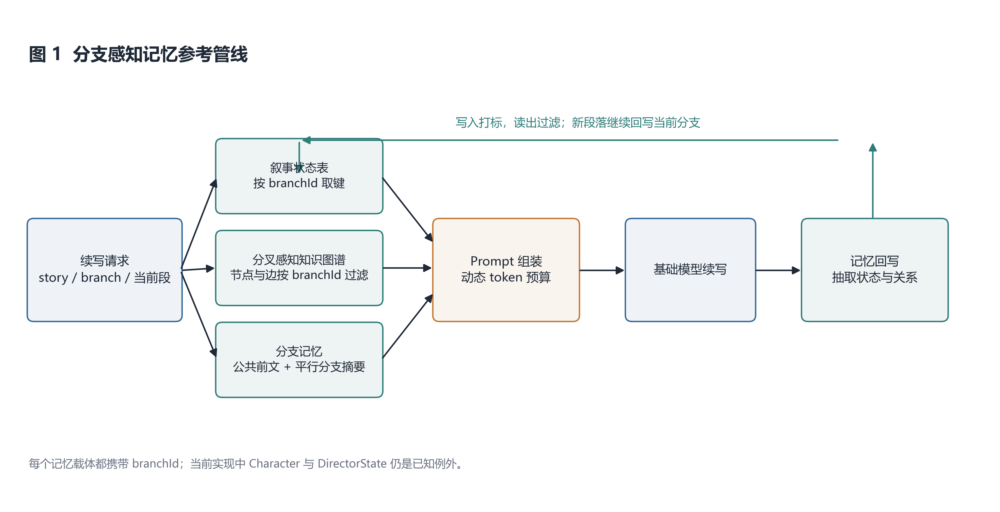
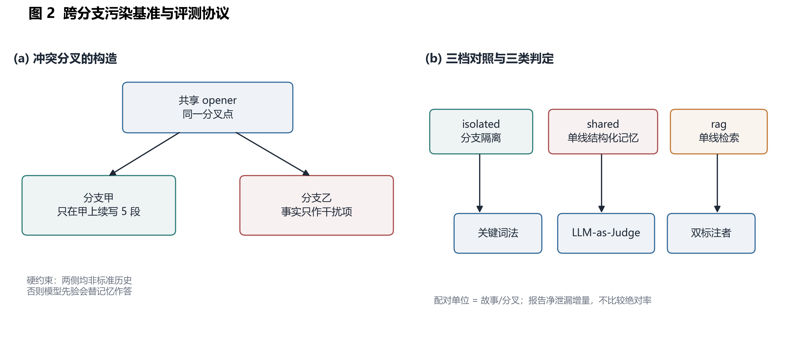
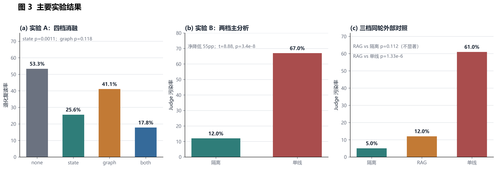

# 古事（Gushi）· 多分支叙事的一致性维护

**论文 v1.1 · 内部评审稿**

> 汇总日期：2026-10-31 ｜ 汇总：肖文宇
> 本稿由仓库 `Docs/ablation/` 下四份分章草稿、摘要/结论与参考文献合并而成。
> 数据以落盘 JSON 与生成报告为准；本稿中的两档主结果与三档 RAG 对照严格分开。

---

## 版本说明

### v1.1 相对 2026-10-19 合并稿的改动

1. 写入 RAG 三档正式结果，并明确“显著优于单线结构化记忆、与 RAG 差异不显著”的边界；
2. 人工评估更新为两位组内标注者，报告 κ = 0.668 与人工净增量 57.4%–69.9%；
3. 新增摘要、关键词、结论、参考文献工作版；
4. 新增三张论文用图（参考管线、基准协议、主要结果）；
5. 统一全稿的 RAG 与人工评估口径，避免把不同跑批或不同标注者的数字混写。

### 当前仍待补的实验性材料

| 项 | 状态 | 对本稿的影响 |
|---|---|---|
| 图像层人工 κ | 待补 | 正文只写文本层强、图像层方向性，不写显著 |
| KG 真实 P/R/F1 | 待补 | 本稿不把 KG 评测作为已完成结果 |
| 第二基础模型 | 未做 | 写入限制，不作跨模型泛化声明 |
| embedding RAG / top-k 敏感性 | 未做 | 当前只声明 BM25 top-3 |
| 正式排版与统一编号 | 待编辑 | 本稿保留四部分源编号，便于审计与交叉引用 |

---

## 题目

**面向多分支叙事一致性的跨分支事实泄漏基准与参考管线**

## 摘要

长程叙事生成中的一致性维护通常依赖外部记忆，但既有状态表、知识图谱与检索式记忆都默认故事只有一条时间线。互动小说与故事树场景允许同一前文分出多条互斥分支，单线记忆会把平行分支的事实当作当前历史注入，造成跨分支事实泄漏。本文将该问题形式化为分支树上的记忆边界问题，构建包含 20 组冲突分叉的诊断性基准，并提出一条显式携带分支标识的参考管线。基准要求每条分叉的两侧均为非标准历史，以避免模型先验替代记忆；每条样本在分支甲上连续续写 5 段，并重复 3 轮，共得到 600 段主分析样本。评测采用关键词法、LLM-as-Judge 与双标注者人工核验，并报告逐故事配对检验。结果显示，状态表记忆将退化复读发生率从 53.3% 降至 25.6%（t = −3.62，p = 0.0011），图谱单独使用不显著（41.1%，p = 0.118）；分支隔离将跨分支污染率从 67% 降至 12%（净降低 55 个百分点，t = 8.88，p = 3.4×10⁻⁸，逐故事 19 胜 1 平 0 负）。在同一批故事的三档外部对照中，分支隔离为 5%、BM25 单线 RAG 为 12%、单线结构化记忆为 61%；RAG 显著优于单线结构化记忆（p = 1.33×10⁻⁶），但与分支隔离的差异不显著（p = 0.112）。两位标注者的标注者间 κ = 0.668，人工加权净泄漏增量为 57.4%–69.9%，与自动判定的 55.0% 同向。本文因此把贡献定位为可复现的跨分支一致性基准、评测协议与参考管线，而不宣称显著优于 RAG。

**关键词：** 多分支叙事；长程一致性；记忆增强；跨分支事实泄漏；基准评测；大语言模型

---

---

# 第一部分 · 引言与方法

> 项目：古事（Gushi）· 多分支叙事的一致性维护
> 配套：[论文_实验与结果_草稿.md](论文_实验与结果_草稿.md) ｜ [评测方法说明.md](评测方法说明.md) ｜ [跨分支污染实验.md](跨分支污染实验.md)
> 编号说明：本稿按整篇论文编号 —— **§1 引言、§2 方法**；《实验与结果》草稿中的 §1–§5 对应整篇的 **§3–§7**。
> 状态：**草稿**。实验数字以 [s30_rounds_report.md](s30_rounds_report.md)、[branch20_rounds_report.md](branch20_rounds_report.md) 为准。
> 实验 B 已扩样到 20 组；本稿已同步三档 RAG 外部对比与双标注者人工评估的最新边界。

## 1. 引言

### 1.1 背景：长程叙事的一致性问题

大语言模型已经能稳定生成通顺、连贯的**单段**叙事，但把生成拉长到数十段之后，**长程一致性**
仍是最主要的失败模式：已经死去的角色重新出场、被毁的城池再次被攻、上一段说"粮尽"、
下一段却"兵精粮足"，埋下的伏笔再无回响。这类错误不会让单段文本读起来有任何异常，
只有把它和几十段之前的内容对照才会暴露 —— 而上下文窗口无论多长，都不可能把全部历史
原样带在手上。

已有工作因此普遍把"记忆"从模型参数里拿出来，做成可检索、可更新的**外部结构**，
在每次续写前检索相关条目注入 Prompt。按记忆的表示形态，大致分三支：

- **符号化状态表**（SCORE[1], 2025）：追踪叙事关键对象的 key-value 状态
  （`{ location: "漠北", status: "俘虏" }`），查询是精确匹配，不受语义检索模糊性的影响；
- **结构化图谱**（DOME[2], 2024）：把已生成内容抽取成实体-关系图，检索的是**关系**而不是文本片段；
- **原始文本检索**（MemLong[3] 等）：保留段落原文做检索增强，保真度高但检索结果冗长、噪声大。

三支的共同前提是：**故事只有一条时间线**，因此"全部历史"可以按时间顺序组织成一份记忆，
检索时只需考虑"与当前上下文多相关"。本文的工作表明，**这个前提在多分支叙事下不成立**，
并且它不成立的方式是可以被量化、被隔离、也被利用的。

### 1.2 多分支叙事：一个被已有记忆模块忽略的维度

互动小说、同人续写与"故事树"类创作场景里，读者并不会线性地把故事读完 ——
他们会在任意一个段落上**分叉**：同一段前文之下，一条支线让主角北上求援，另一条让主角南下死守。
分叉可以继续分叉，故事于是不再是一条线，而是**一棵树**。多分支并不只是 UI 形态，
它对记忆系统提出了一个单线场景里根本不存在的要求：

> 记忆必须**同时按"时间"和"分支"两个维度组织**；在当前分支上检索到的历史，
> 不能包含只发生在**平行分支**上的事实。

沿用单线记忆会直接造成**跨分支事实泄漏**（cross-branch contamination）：
分支 A 里写定的事实——某人是此战主将、某城已被攻拔、某人已经身死——会被当作"历史"
注入到分支 B 的续写 Prompt 里，模型于是顺着 A 的既成事实把 B 写下去，
两个分支在语义上悄悄合流。

这不是一个只影响观感的小问题。跨分支污染在创作场景下**直接摧毁分支的意义**：
读者选择"另一条路"的全部价值，就在于那条路上发生的事不一样；
一旦分支 B 被分支 A 的记忆牵着走，用户看到的是同一条故事的两个抄本。

已有工作并未处理这一维度：SCORE 的状态表与 DOME 的图谱都建立在"故事 = 单一时间线"的
假设之上，记忆结构里**没有任何字段**标记一条事实来自哪条分支。这一点构成了本文的切入点。

### 1.3 研究问题

围绕"记忆注入能否在长程续写中维持一致性"与"记忆注入是否必须分支感知"，
本文报告四项研究问题（实验设计与数据见配套稿 §1）：

| 编号 | 研究问题 | 结论 |
|---|---|---|
| **RQ1** | 记忆注入能否降低退化复读？ | ✅ 能，多重比较校正后仍显著 |
| **RQ2** | 知识图谱单独是否有效？ | ❌ 未达显著（p = 0.118） |
| **RQ3** | 两个模块叠加是否优于单模块？ | ❌ **无差异**，互补性假设不成立 |
| **RQ4** | 分支隔离能否抑制跨分支事实泄漏？ | ✅ 相对单线结构化记忆显著；与外部 RAG 差异不显著 |

RQ1、RQ4 构成两条**确认性结论**；RQ2、RQ3 是两条**否定性结论**，
其中 RQ3 曾是本文预设的卖点，被扩样后的数据推翻，我们按要求撤回（详见 §1.5）。

### 1.4 本文贡献

本文的工作按其性质可分为四类：**一个被命名的问题、一个可复现的基准、两条实证结论、以及一组方法学反思**。

先说明定位：**分支感知的记忆隔离是本文的参考实现，我们不主张"提出了一个新架构"** —— 理由见本节末尾。

**C1（问题）—— 命名并形式化「跨分支事实泄漏」。**
多分支叙事中，故事不再是单一时间线，而是一棵树。已有记忆模块（SCORE、DOME 等）均以
"故事 = 单一时间线"为前提，其记忆结构里**没有任何字段标记一条事实来自哪条分支**。
当平行分支的事实被当作"历史"注入当前分支，两条分支会在语义上悄悄合流，
**分叉创作的意义被直接削弱**。本文给出该问题的形式化定义（§2.1），
并说明单线记忆在结构上必然导致它（§2.5）。

**C2（基准）—— 一个可复现的诊断性基准。**
我们构建了 **20 组冲突分叉**作为刺激材料：每条分叉在一个分叉点上给出两条
**互斥且均非正史**的走向，续写**只在其中一条上进行**，另一条的事实仅作为干扰项进入记忆。
基准规模为 20 组 × 2 档 × 5 段 × 3 轮 = **600 条标注样本**，
配以**双度量（关键词 + LLM 判官）+ 人工锚定**的评测协议。
**构造约束本身即是设计成果**：v1 的失败使我们识别出
"乙分支若为史实，模型的先验知识会替记忆作答"这一混淆变量（§2.9）。

**C3（实证）—— 两条结论，一正一负。**

- **正**：分支隔离把跨分支泄漏从 67% 降到 12%，**净泄漏增量 55 个百分点**
  （t = 8.88，df = 19，p = 3.4×10⁻⁸；逐故事 **19 胜 1 平 0 负**），
  3 比较与最保守的 4 比较 Bonferroni 校正后均显著。
- **外部基线边界**：在同一批 20 组故事上补跑三档对照后，分支隔离为 5%，RAG 单线检索为
  12%，单线结构化记忆为 61%。RAG 显著优于单线结构化记忆（t = 6.93，p = 1.33×10⁻⁶），
  但与分支隔离的 7 个百分点差异不显著（t = 1.67，p = 0.112）。因此本文主张的是
  “分支隔离显著优于强泄漏的单线结构化记忆”，不主张“显著优于 RAG”。
- **负**：在 30 故事的四档消融中，**知识图谱单独无效**（41.1%，p = 0.118），
  **叠加亦不优于单模块**（t = −1.16）。这说明"**堆叠更多记忆模块不等于有效**" ——
  它与"分支隔离有效"合在一起，才构成完整论证。

**C4（方法学）—— 指标失效与构念效度。**
两处经验：

1. "相邻段重复度均值"是一个**双峰指标**，被稀疏的整段照抄事件支配，轮间差大于档间差；
   改用故事级发生率后结论才稳定复现。
2. 图文一致性实验的**逐图指标**与其声称测量的"**跨图一致性**"之间存在**构念错位**，
   因而其不显著结果**不能**读作"机制无效"。

这两条都属于评测方法本身的问题，我们认为对本领域有复用价值。

**关于参考实现的定位。**
我们把符号化状态表与分叉感知知识图谱统一到同一条记忆管线上，
并让每个记忆载体显式携带分支标识（§2.3–§2.6）。
但实验结果显示，**只有状态表这一部分被证明有效**，图谱部分未达显著。
因此我们不把它作为"新架构"的贡献来主张，而是作为**可复现的参考实现**报告 ——
这也正是基准类工作的常规形态：参考实现应当简单、可复现，而非以新颖性取胜。

**一条被撤回的假设（见 §1.5）。**
原假设"状态表与知识图谱互补、叠加最优"不成立：知识图谱单独未达显著，
叠加档与单模块档**无差异**。5 故事时该假设成立（当时 `both` 单调最优），
扩到 15 故事即消失，30 故事仍未复现 —— 典型的小样本高估。
我们把准确表述改为"**叠加不劣于单模块，但互补性未获证据**"。

**一条明确的适用条件。**
记忆注入的收益大小基本是"这个故事原本有多糟"的镜像：
基线退化复读率 33% 与 83% 的两组故事，在状态表档下分别落到 28.2% / 26.2%。
这不是缺陷而是适用条件 —— **记忆注入在模型本身倾向于复读的题材上收益最大**，
在模型本来就不复读的题材上收益接近于零。

### 1.5 关于负面结论的说明

本文的 RQ2、RQ3 与 §1.4 的"撤回"都不是修辞，而是实验记录的一部分。
配套稿 §5 完整列出了**六个被数据推翻的假设**及其检验过程，包括本稿 C4 提到的指标替换。
我们选择保留这些记录，理由是：本领域目前以 5–15 个故事为规模的小样本实验居多，
而我们的经验是**这个规模足以稳定地产生假阳性**——"互补性"这个假设在 5 故事上成立得很干净，
到 15 故事就消失了。只报告该规模下的效应量而不报告样本量，
会让后来的工作重复同一条弯路。

---

## 2. 方法

### 2.1 问题定义与符号

一个**故事** $S$ 是一棵**分支树**。树的根是一条线性前文，每个节点是一个**段落**
（segment），边表示"下一段"。在任意段落上都可以生成一个新的子节点，
从而开启一条新的**分支**（branch）；同一父节点下的不同子节点属于不同分支。

形式化地，段落 $s$ 带有分支标识 $b(s)$，并沿 `parentSegmentId` 指回父段。
一条分支 $B$ 是若干段落的序列，满足：$B$ 中相邻两段有父子关系，
且 $B$ 中所有段落的分支标识相同。分支的**分叉点**（fork point）定义为

$$\mathrm{fork}(B_1, B_2) = \arg\max_{s \in B_1 \cap B_2} \mathrm{depth}(s)$$

即两条分支共享的**最深**祖先段 —— 实践中沿父指针链求最近公共祖先得到（§2.6）。

续写任务即：给定故事 $S$、当前分支 $B$ 与当前末端段落 $s_t$，
生成下一段 $s_{t+1}$，使其在文体上与 $s_t$ 一致、在事实上与 $B$ 上 $s_t$ 之前的
全部历史一致，**且不被 $B$ 之外的分支上的任何事实影响**。最后一条是本任务
区别于单线续写的核心约束。

### 2.2 系统总览

系统由四个部分构成，围绕一次续写请求串成一条管线：

```
续写请求 (storyId, branchId, 当前末端段)
      │
      ├─① 记忆检索 ──┬─ 叙事状态表    （按 branchId 取键）
      │              ├─ 分叉感知知识图谱（按 branchId 过滤节点/边）
      │              └─ 分支记忆      （分叉点 + 平行分支摘要）
      │
      ├─② Prompt 组装：按动态 token 预算把记忆块注入模板
      │
      ├─③ 生成：基础模型续写
      │
      └─④ 记忆回写：从新段落抽取状态与实体-关系，写回上述两个结构
```

关键设计是**检索与回写的每一步都携带 `branchId`**：写入时打标，读出时过滤，
中间不存在任何"跨分支可见"的中间结构。**这条原则在实现上有两处例外**，
都不是设计意图而是既有代码的既成事实，我们在 §2.5 与 §2.10 如实标出 ——
其中一处（角色登记表）会实际影响实验，本文在实验脚本层做了隔离（§2.10-1）。



> **图 1** 分支感知记忆参考管线。写入时打标、读取时按 `branchId` 过滤；新段落继续回写当前分支。

### 2.3 叙事状态表

状态表对应 SCORE[1] 的 Dynamic State Tracking，回答的是"**现在是什么状态**"。

**表示。** 追踪的对象不限于角色，而是所有对一致性有影响的**叙事关键对象**，
共六类：`character` / `location` / `faction` / `item` / `relationship` / `event`。
每个对象的状态是**符号化的 key-value 表**，例如
`{ location: "漠北", status: "俘虏", isAlive: "false" }`。
选择符号表示而非自然语言描述，是为了让冲突检测退化成**精确匹配**：

> 若上一段记录"某人为将"，本段却写他在另一处领兵，那么他不是"语义上有点怪"，
> 而是**同一个键被赋了两个互斥的值** —— 这可以被机械地检出。

**更新。** 每写完一段，把该段文本交给模型做一次增量更新
（`updateFromSegment`）：模型输出本次新增或变更的对象与属性，
系统按 `(name, branchId)` 合并进已有状态表，同时刷新 `lastSeenSegmentId`。
抽取量上有硬上限（每次至多若干实体与关系），避免单段引入过多噪声。

**注入。** `buildPromptContext` 按 `lastSeenSegmentId` 倒序取最近活跃的
30 个对象，按类型分组渲染成 markdown 块；属性为空的键不输出。

**冲突检测。** `checkPropertyConflicts` 比对符号状态与当前段落文本：
键存在且取值互斥时产生告警。其中"敌对势力"这一类关系的**正确来源是知识图谱的
`conflicts_with` 边**（§2.4），代码里另有一张内置的历史势力对照表，
但它**只作兜底**——覆盖面天然有限，不能泛化到任意势力名。

### 2.4 分叉感知知识图谱

图谱对应 DOME 的 Memory-Enhancement Module，回答的是"**跟什么有关**"。
它与状态表互补：状态表给事实，图谱给关系。

**结构与存储。** 节点五类：`character` / `event` / `location` / `branch_point` / `faction`；
边九类：`causes` / `leads_to` / `located_at` / `involves` / `conflicts_with` /
`ally_of` / `belongs_to` / `precedes` / `parallel_to`。
图谱持久化到单个 JSON 文件（`data/knowledge-graph.json`），进程内持有一份可读副本，
写操作整体落盘。这一选择是为实验可复现性服务：图谱状态是一份可以直接 diff、
直接打包进产物的**文本文件**，规模到需要换成图数据库时再迁移。

**分支维度。** **每个节点与每条边都带 `branchId` 字段**（这是本文相对 DOME 的改动），
每一次检索都做 `branchId` 相等过滤——查询邻域、取敌对势力、构建 Prompt 上下文三处均是。

**检索。** `queryNeighborhood(name, branchId, hops = 2)` 从命名实体出发做 2 跳 BFS。
`buildPromptContext` 把当前段落的角色名与地名**一起**作为查询种子，
对每个种子取邻域后在图上做**并集**（旧实现是各查各的、再把子图逐一打印，
注入内容里约 1 300 字符是纯重复，白白挤占上下文预算）。随后依次：

1. **同义节点归并** —— 同一实体在不同段落可能被抽成不同类型（实测"长安"既被抽成地点、
   又被抽成角色），按名字归并，保留最早登记的节点；
2. **关系净化**（`purifyEdges`）—— 去自环、去反向重复、抑制极性矛盾
   （`A 同盟 B` 与 `A 敌对 B` 不允许同时注入 —— 模型拿到互相矛盾的事实时倾向原地打转，
   这正是退化复读的疑似机制之一）；
3. **排序截断** —— 与当前段落实体直接相连的边优先（+1000），其次按端点度数排序，
   取前 24 条；节点名按类型至多保留 12 个。

**抽取。** 每写完一段调用 `extractFromSegment`，由模型抽取实体与关系并写回图谱，
硬上限为每次 12 个实体 / 15 条关系，写入时统一打上当前 `branchId`。

### 2.5 分支隔离机制：三个载体的统一做法

三个记忆载体形态不同（关系图 / 键值表 / 摘要链），但隔离遵循同一条原则：
**写入时打分支标记，读出时按标记过滤，不设跨分支可见的中间层。**

| 载体 | 存储形态 | 隔离做法 |
|---|---|---|
| 知识图谱 | `data/knowledge-graph.json` | 节点与边各带 `branchId` 字段；三处检索点全部按 `branchId` 相等过滤 |
| 叙事状态表 | `DirectorState.worldVariables` 下的 JSON | **键名命名空间**：`narrative_states_${branchId}`；同一故事的平行分支各存一份，互不可见 |
| 段落摘要 | `SegmentSummary` 表 | 表自带 `branchId` 列；分支记忆查询按当前分支取摘要 |
| ~~角色登记表~~ | `Character` 表 | ⚠️ **无 `branchId`，故事级共享** —— 隔离的例外，见 §2.10-1 |

状态表与图谱的底层存储**共享同一个故事级容器**（状态表是
故事级 JSON blob 里的一个键），隔离完全由**键名命名空间**实现而非容器隔离。
这样做的好处是同一故事的状态可在一次读事务内取全；代价是**隔离的正确性依赖命名规范**——
任何一处忘记拼 `branchId` 的读写都会静默地跨分支串数据。

### 2.6 分支记忆与分叉点定位

前两节解决"不串"，本节解决"该共享的要共享"。
两条分支在分叉点**之前**的历史是完全相同的，如果因为分支隔离而把这段共享历史
也屏蔽掉，模型会丢失人物前史与动机，续写质量下降。分支记忆因此显式区分两段历史：

- **分叉点定位** `findDivergencePoint(storyId, branchId1, branchId2)`：
  沿 `parentSegmentId` 链向上求**最近公共祖先**，即两条分支共享的最后一个段落；
- **平行分支摘要** `getAlternateBranchSummaries`：取当前分支之外的分支摘要，
  用于告诉模型"与当前分支并行的分支发生过什么"——注意这**不是**把平行分支的事实
  当历史注入（那正是跨分支污染），而是以"另一条分支上"的**显式标注**形式给出。
  实验 B 的 `shared` 档恰恰去掉了这层标注，把两套事实当成同一个分支的历史——
  这正是 SCORE / DOME 式单线记忆在多分支下的等价形态；
- **共享角色状态同步** `syncSharedCharacterStates`：分叉点之前的角色状态属两条分支共有，
  只同步这一段，分叉点之后各自独立演进。

### 2.7 Prompt 组装与动态 token 预算

**固定部分。** 六块与记忆无关的模板文本占固定预算：
风格指令 80 / 故事元信息 150 / 风格锚点 250 / 节奏指令 120 / 记忆提醒 120 / 续写指令 100，
合计 820 tokens。

**动态部分。** 剩余预算按**当前实际存在的数据**加权分配——空块不占配额，
避免"没有分支记忆却留出 10% 空位"造成的浪费：

| 块 | 权重 | 旗标 |
|---|---|---|
| 角色上下文 `characterContext` | 0.15 | 本段有角色 |
| 事件追踪 `eventTracking` | 0.15 | 本段有事件 |
| 分支记忆 `branchMemory` | 0.10 | 存在平行分支 |
| 世界与事实 `worldAndFacts` | 0.20 | 有世界状态 |
| 前文上下文 `contextHistory` | 0.40 | 恒真 |

权重在旗标为假时置零，再整体归一化；整除的**余数全部并入前文上下文**，
保证总预算不浪费。默认总预算 6 000 tokens，可用动态预算即 5 180。

**注入顺序**（自前向后）：风格指令 → 故事元信息 → 风格锚点 → **状态表** → **知识图谱**
→ 角色状态 → 事件追踪 → 分支约束（分叉创作 / 分叉续写两种模板）→ **分支记忆**
→ 导演覆盖 → 前文上下文 → 时间线 → 同人设定 → 节奏指令 → 记忆提醒 → 续写指令。

两个记忆块被放在风格锚点之后、前文上下文之前，是为了让"结构化事实"先于"原始文本"
进入上下文：模型在读到最近几段原文之前，先拿到当前分支的事实清单，
减少它按原文表面连贯性自行补全矛盾事实的空间。

### 2.8 消融实现

四档消融（`none` / `state` / `graph` / `both`）不通过复制代码路径实现，
而是由三个环境变量在**同一条管线**上开关：

| 变量 | 语义 |
|---|---|
| `MEMORY_MODULES_ENABLED` | 总开关，为 `false` 时关闭全部记忆注入（= `none` 档） |
| `MEMORY_STATE_TABLE` | 单独关闭状态表，其余模块照常 |
| `MEMORY_KNOWLEDGE_GRAPH` | 单独关闭知识图谱 |

判定一律用"不等于字符串 false"（默认开启），避免"未设置"被误判为关闭。
四档的**初始记忆数据完全相同**，只切换"是否注入"与"是否增量更新"，
从而把差异归因到记忆注入本身，而不是喂养数据的多少。

### 2.9 基准构建：冲突分叉的设计与发布

本节说明基准是怎么造出来的、为什么这样造，以及它被哪些约束限定。
**建议与 §1.4-C2、评测方法章 §3–§4 联读。**

#### 2.9-1 构造目标

基准必须能够区分"**记忆是否按分支隔离**"。为此需要构造一种情境：

- 模型若遵守当前分支，就**必然不会**使用另一分支的事实；
- 而若记忆未按分支隔离，另一分支的事实就会以"历史"的形式出现在检索结果中。

换言之，判据不是"模型提到了什么词"，而是"**模型是否采纳了另一分支的设定**"。

#### 2.9-2 三条构造约束（每条都来自一次失败）

| # | 约束 | 若不满足会怎样 | 教训来源 |
|---|---|---|---|
| **A** | 两条分支必须**互斥** | 两档的检索空间内容无差别，实验失去对照意义 | 设计阶段 |
| **B** | 两侧**都不能是标准历史** | 模型的先验知识会替记忆作答，测到的是"先验 vs 记忆"，不是"隔离 vs 不隔离" | **v1 的失败**（净增量仅 12 个百分点，且污染只出现在 4 个"乙分支=史实"的组上，其余 8 组两档均为 0） |
| **C** | marker 必须在"**模型不会自发写出**"的意义上显著 | 关键词指标会把模型先验判成泄漏，产生假阳性 | 三次试跑：周殷（垓下）、褒斜（马嵬坡）、柯枝（郑和） |

> **约束 B 是本文方法论的核⼼之一。** 它说明：基准的难点不在"造多少组"，
> 而在"**让模型不得不依赖记忆**"。这一点与构念效度一文的论点同源 ——
> 只有当任务真的需要被测能力时，测出来的才是该能力。

#### 2.9-3 规模与分档

| 维度 | 规模 |
|---|---|
| 故事 / 分叉组 | **20 组** |
| 对照档 | 2 档（`isolated` 分支隔离 / `shared` 单线记忆） |
| 每档续写段数 | 5 段 |
| 独立轮次 | 3 轮 |
| **标注样本** | **600 段** |
| 完整性 | 三轮各 40/40 组合，零失败 |

#### 2.9-4 标注与判定协议

三个判定器并行，关系与失效模式见评测方法章：

| 判定器 | 角色 | 温度 / 确定性 |
|---|---|---|
| **关键词匹配** | 粗筛、可复算、可审计 | 确定性 |
| **LLM 判官** | **主判定** | **温度锁 0**，3 次采样取中位数 |
| **人工盲评** | 效度锚定（36 条分层抽样） | 单人标注，见 §2.10-4 限制 |

三者一致率：人工 × 判官逐段 74.3%（Cohen κ = 0.47）；
关键词 × 判官在隔离档约 70%、单线档约 82%。

#### 2.9-5 统计口径

- **配对单位 = 分叉组**（不是段落、也不是轮次）；
- 配对 t 检验，报告精确 p 值（不完全 beta 函数计算，非查表）；
- **Bonferroni 校正**，同时报告 k=3 与最保守的 k=4；
- 同时报告**逐故事支配关系**（更优 / 打平 / 更差），比 p 值对小样本更敏感。

#### 2.9-6 数据卡（按 Datasheets for Datasets 的七节）

| 节 | 内容 |
|---|---|
| **动机** | 多分支叙事中的跨分支事实泄漏尚无基准可测 |
| **构成** | 20 组分叉 × 2 档 × 5 段 × 3 轮；中文历史/古典题材；标注为段落级二分类（是否污染） |
| **采集过程** | 分叉由人工设计，续写由 `deepseek-chat` 生成；判定由 LLM 判官产生，经 36 条人工抽验 |
| **预处理** | 生成文本未做清洗；判定结果原样保存 |
| **用途** | 推荐：评测分支感知记忆隔离。**不推荐**：评测一般写作质量、跨语言泛化 |
| **分发** | 数据与脚本随论文一并发布（仓库内 `Docs/ablation/`）；分叉定义在 `tests/ab_branch_isolation.ts` |
| **维护** | 由项目组维护；新增分叉需通过 `validateForks` 自检（marker 不得出现在 opener 中） |

#### 2.9-7 与既有基准的差异

现有长期记忆基准（LoCoMo、LongMemEval）把记忆的**时间跨度**推到数十个会话，
但均假设**单一时间线**。多分支叙事要求记忆同时按**时间**与**分支**组织 ——
这一维度未被覆盖，是本基准的位置。

#### 2.9-8 基准自查（对照 BetterBench 的最佳实践）

| 最佳实践 | 我们的状态 |
|---|---|
| 被测现象有明确定义 | ✅ §2.1 形式化 |
| 任务来源与构造方式可追溯 | ✅ 分叉定义在代码中，逐组可查 |
| 数据集文档（数据卡） | ✅ §2.9-6 |
| 评测指标有定义 | ✅ 评测方法章 §3–§4 |
| **报告统计显著性** | ✅ 配对 t 检验 + Bonferroni + 精确 p |
| **结果可复现** | ✅ 全部原始生成文本与判定结果入库；`--report-only` 可只重建报告不重跑 |
| 报告人类基线 | ⚠️ 仅 36 条抽样（限制见 §2.10-4） |
| 报告局限与不推荐用途 | ✅ §2.10、§2.9-6 |

> 这张表刻意对着 BetterBench 的发现写：它指出"**多数基准不报告统计显著性、
> 也不便于复现**"，而这两点正是我们已经做到的。建议在论文中保留这张对照表。

### 2.10 已知局限

**（1）角色登记表是故事级的，且它会被当作硬约束写进 Prompt。**
`Character` 表没有 `branchId`，因此一个故事下的角色对**所有分支可见**。
这不只是"少一个过滤条件"：`buildMemoryReminderPrompt` 会把登记到的角色名以
**「必须逐字原样使用，禁止替换、简写、形近字替代」**的形式写进 Prompt 的硬约束块。
换言之，一条只属于分支 B 的角色名，会被当作"已建立的人物"要求分支 A 的续写去使用它。
这是本文隔离原则（§2.5）的一处真实例外，我们是在实验脚本的试跑中发现的：

> 冲突分叉「垓下之围」的两条走向分别以**钟离眛**与**周殷**为断后之将。
> 试跑中，**分支隔离档**的两段续写都出现了「周殷」——但该档的检索空间里
> 根本没有乙分支的事实。原因是两人都被登记进了故事级角色表，
> 于是甲档的 Prompt 里也出现了"周殷"这个名字，并被要求逐字沿用。
> LLM 判官对这两段都判**干净**：模型只是提到了这个名字，
> 并没有采纳乙分支"周殷领后军断后"的事实。

两点结论：其一，**关键词指标在这种情形下会假阳性**，我们把 LLM 判官作为主指标、
并报告两者的一致率，正是为了兜住这类情形；其二，`shared` 与 `isolated` 两档的差别
在脚本层需要显式保证 —— 我们在建场景时只把**本次确实挂到当前分支名下**的角色
登记进故事，使隔离档的 Prompt 里不出现乙分支的人名。
需要说明的是，这处修补没有改变 `shared` 档的泄漏路径：单线档的泄漏来自
状态表与图谱（§2.6），与角色表无关。

**（2）导演状态也是故事级、不是分支级的。** 视觉链路上的 `DirectorState`
以 `storyId` 为唯一键（`storyId @unique`，**无 `branchId`**），
每条故事只保存一份场景状态快照。这意味着图像管线在读"当前场景"时，
拿到的是**该故事所有分支共用**的一份视觉世界状态，而不区分读者当前在哪条分支上——
这是与文本侧机制不对等的一条跨分支通道。本文的实验只覆盖文本记忆，未覆盖该路径；
在图像生成真正端到端跑通之前，这里的不一致不会被现有指标检出
（我们把它记为待修问题，而不是已解决的问题）。

**（3）分支隔离的正确性依赖命名规范。** 如 §2.5 所述，状态表的隔离由
`narrative_states_${branchId}` 这个字符串约定维持，类型系统不提供保护。

**（4）实验 B 的部分 marker 在模型先验里可及，关键词指标对这几组偏保守。**
marker 的选择标准不是"正史与否"，而是**显著度**：marker 必须是模型在只看到
公共前文时**不会主动写出**的字符串。试跑（8 组新分叉 × 2 档 × 2 段）发现三组不满足或部分不满足——

| 故事 | 乙分支 marker | 情形 | 处置 |
|---|---|---|---|
| 垓下之围 | 周殷 | 名字被角色登记表直接写进 Prompt（§2.10-1） | **已修**：脚本层不再登记乙的角色；修后复跑，隔离档 Prompt 里已无「周殷」 |
| 马嵬坡 | 褒斜 | 褒斜道是秦岭最著名的通道，模型自行提及 | 保留，记为刺激材料瑕疵；判官指标不受影响 |
| 郑和下西洋 | 柯枝 | 柯枝是宝船队常规经停港，模型自行提及 | 保留，记为刺激材料瑕疵；判官指标不受影响 |

需要如实说明的是，修掉角色表那处泄漏之后，「垓下之围」在**试跑**（每组 2 段）中的
判官指标两档都是 0%（隔离档 0% ／ 单线档 0%），我们据此一度把它标为**无效刺激**（持平）。
**正式跑批（20 组 × 3 轮）推翻了这个判断**：该组实际是 **47% vs 100%** ——
试跑时"两档皆 0"是每组只有 2 段的产物，不是这一组真的无效。
处置方式（不因试跑结果回头重新设计分支设定，那样等于按结果挑刺激材料）仍然正确，
但当时给出的"无效刺激"这个**判断**本身不成立，一并记录在此。
它的 marker 问题仍记入下一轮设计（下一轮应改用"模型无先验的中性细节"作 marker，
而不是在这一轮里就地修补）。

后两组的共同后果是**关键词指标同时抬高了两档**，使测得的差值偏向保守；
本文的结论以判官指标为准，并逐故事报告两者的一致率。

**（5）实验 B 的刺激材料规模有限且带设计约束。** 每组分叉的两条走向都必须
**同时满足**"互斥"与"都不是正史结局"——若任一侧是正史，模型的先验知识就会替记忆回答问题，
测出来的不是记忆隔离的效果。这条约束显著限制了可用的分叉点数量（现有 20 组），
扩样成本主要在这里而非生成成本。

**（6）基础模型单一。** 全部实验基于 `deepseek-chat`，
跨模型的泛化性未做验证。

---

# 第二部分 · 评测方法

> 撰写：黄夏薇 ｜ 2026-10-10 ｜ 分支 `integration/week-0920`
> 配套：[论文_引言与方法_草稿.md](论文_引言与方法_草稿.md)、[论文_实验与结果_草稿.md](论文_实验与结果_草稿.md)、
> [评测方法说明.md](评测方法说明.md)、[human_eval/人工评估方案.md](human_eval/人工评估方案.md)、
> [human_eval/人工评估报告.md](human_eval/人工评估报告.md)
>
> 本章回答一个问题：**本文的"一致性"是怎么测出来的，这些度量凭什么可信。**
> 本文的度量体系是"两条自动指标 + 一条人工基准"，三者关系与各自的失效模式都在本章交代。

## 1. 评测对象与三个判定器

本文有两个需要度量的性质，各自配了不同的判定器：

| 判定器 | 任务 | 服务对象 | 规模 |
|---|---|---|---|
| **四维一致性评分器**（LLM-as-Judge） | 四维评分 1–5 分 | 实验 A：记忆注入消融 | 100 条 × 3 次采样 |
| **跨分支污染判定器**（LLM-as-Judge，二分类） | 二元判定「是否污染」 | 实验 B：分支隔离 | 600 段 × 3 轮 |
| **关键词法** | 二元判定（词面匹配） | 实验 B（仅作佐证） | 同上 |
| **人工判定** | 二元判定 | 实验 B（效度锚定） | 36 段 × 1 位标注者 |

> 📌 **本文刻意不把三个判定器的结论混用。** 三者任务不同（四维打分 vs 二分类）、
> 服务对象不同（实验 A vs 实验 B），人工锚定只覆盖其中之一 —— 覆盖范围见 §5。

两个自动判定器的**提示词、上下文与判定标准在本文中全文给出**，以保证可复现。

---

## 2. 四维一致性评分器

### 2.1 维度与锚点

四维各 1–5 分，**各自独立套用同一套锚点**：

| 维度 | 定义 |
|---|---|
| **角色稳定** | 角色的身份、性格、说话方式、能力是否与角色设定和前文一致。OOC、已登场角色凭空消失、冒出未交代来路的新角色，均扣分。 |
| **事件因果** | 事件之间是否有清晰因果链，人物行为动机是否成立。无铺垫的突兀转折、情节靠巧合硬推，均扣分。 |
| **时间线连续** | 时间推进是否连贯有序，与梗概/前文交代的时间、季节、地点是否矛盾。 |
| **情感连贯** | 情感基调是否连贯、有合理过渡与层次。情绪突变、情感扁平，均扣分。 |

| 分 | 含义 |
|---|---|
| 5 | 优秀：该维度全程无瑕 |
| 4 | 良好：仅个别轻微不足，不影响阅读 |
| 3 | 及格：有明显问题但不严重，整体仍可读 |
| 2 | 较差：多处出错，已明显影响阅读体验 |
| 1 | 很差：严重违反，破坏文本基本可信度 |

**总分 = 四维之和（4–20）。报告四维分与总分，不报告加权总分** —— 权重没有依据，
且会掩盖维度间的分歧模式。

**打分纪律**（写入 system prompt）：严格基于文本证据；明确区分**连贯性**与**文采**，
不因"写得美"抬分；某维确实无法评估时给 3 分并说明，而非跳过；每条理由须指向
文本证据且 ≤40 字；不机械回避 1 分与 5 分。

### 2.2 上下文为什么要带角色设定

判断"角色稳定"需要基准，否则只能靠先验知识猜。故把每个故事的 `characters[].traits`
一并喂入；起始段作为"前文"提供，使时间线判断有参照。

### 2.3 可复现性：两个必须记录的工程事实

本文对每条样本**采样 N 次并取中位数**作为最终分。这不是可选优化，而是**必需步骤** ——
理由如下。

**① `temperature=0` 不保证确定性。** 相同输入、相同参数，DeepSeek 仍会偶发返回不同分数。
实测（桃园结义 4 档 × 每条 10 次独立采样）：

| 指标 | 数值 |
|---|---|
| 10 次采样**完全一致**的（条目 × 维度）比例 | **13/16 = 81%** |
| 全部 16 个（条目 × 维度）的平均标准差 | **0.079**（1–5 量表） |
| 有分歧的 3 个 | 均为"主分 + 偶发 ±1" |
| 全量 100 条 × 3 次采样的最大极差 | **1 分**（无更大） |

即：**约 19% 的条目 × 维度出现 ±1 漂移**。残余噪声是偶发偏移，
**中位数聚合可完全吸收**，故默认 `--repeats=3`。

**② 结构化输出的失败会伪装成成功。** DeepSeek 的 `response_format: json_object`
会概率性丢掉结尾的 `}`（实测命中率约 **37%**，3/8），而 `finish_reason` 仍报 `stop`、
`completion_tokens` 也正常，**调用方无法从响应元数据察觉**。

危害不止于解析失败：平衡括号匹配会退而匹配到**内层**的 `{"score":..,"reason":..}`
并成功返回，于是拿到一个缺 `character` 等键的对象 —— **失败伪装成了成功**。

应对：`repairTruncatedJson()` 按括号栈补齐缺失闭合符（跳过字符串内部与转义符），
修复后**解析失败率 25% → 0**。该补丁对截断与真·非法 JSON 都安全，
因为它在原样解析成功时不会被触发。

> 任何用 LLM 做结构化输出评测的工作都应记录此类 API 层不稳定性 ——
> 它直接影响数据完整性，且不体现在 API 的错误返回里。

---

## 3. 跨分支污染的双度量

实验 B 的指标是**跨分支污染率**：在**分支甲**续写的段落中，引用了**分支乙**独有
事件或状态的段落占比。污染率越低越好。

同一批数据用两种独立方法判定，**并列报告**：

| | 关键词法 | 跨分支污染判定器 |
|---|---|---|
| 做法 | 段落是否命中乙分支专属**措辞** | 把甲/乙两条设定 + 正文给模型，判定主角是否**确实进入乙的地点/做了乙的事** |
| 性质 | 客观、便宜、可复算 | 能处理语义改写 |
| 定位 | **仅作佐证** | **主判定** |

### 3.1 为什么关键词法只能当佐证

实测两法分歧很大，且**两个方向的错都出现过**：

- **假阳性**：荆轲刺秦的"蓟城""辽东"是燕国地名，属常识。隔离档照常提到，
  关键词法判 100% 污染，而判定器判 0%。
- **假阴性**：桃园结义单线档写"欲往许都投曹孟德"命中「许都」；
  但同一档写"投曹公""往依之"等改写表达时，一个标记词都不命中。

结论：**词面重合与"主角是否真的进了乙分支的设定"是两件事。**
标记词的选择标准因此**不是"是否在正史里"，而是"显著度"** ——
必须是模型只看公共前文时**不会主动写出**的字符串，否则会把模型先验当成泄漏。

> 本文在正文中**并列给出两法的数字**，正是为了让这个分歧可见，
> 而不是把关键词法包装成一个有效指标。本项目已因
> 「一个看起来合理的指标其实在测别的东西」吃过一次大亏
> （见 [退化复读诊断.md](退化复读诊断.md)），故引入新度量时把失效模式一并写明。

### 3.2 判定器的提示词（全文）

```
你是一个严格的文本审核员。下面给你两条互斥的故事分支设定，以及一段基于【分支甲】写出的续写正文。
请判断：这段续写是否把故事主角放进了分支乙的地点、或让主角做了分支乙的事件？

判定标准（务必严格按此执行）：
- 只有当主角确实去了乙的地名、或确实做了乙的事、或确实处于乙的状态时，才算污染（contaminated=true）
- 仅仅出现了乙分支里的历史人物名字（例如曹操、孙权、回纥这类名人），但主角仍留在甲分支的地点、
  仍在做甲分支的事 —— 不算污染
- 主角在路上偶遇某个名人、或作者凭空插入一段与乙分支设定无关的插曲 —— 不算污染
- 提到与两条分支都无关的常识性历史背景 —— 不算污染
- 拿不准时判 false

换句话说：判 true 需要正文里有主角与乙分支地点/事件的直接绑定，不能只是词面重合。
只输出 JSON：{"contaminated": true 或 false, "evidence": "构成污染的原句；判 false 则留空"}
```

> ⚠️ **判定温度锁 0**：判定是**度量**，度量本身不能是随机的。默认走题材推断会拿到
> 温度 0.5，同一段文本两次判定可能给出相反结论。这一条是踩坑后补上的。

---

## 4. 人工评估：为自动判定提供效度锚定

### 4.1 为什么必须做

主结果（净泄漏增量）由上述两个自动判定器产出，而它们**彼此不一致**、
且**从未与人类判定对齐过**。这是一个结构性缺口：一个"校正后显著"的主结果配一个
未经外部验证的自动指标，是审稿人最可能直接质疑的地方。

### 4.2 抽样

从实验 B 的 600 段中**分层抽样 36 条**，按 `档位 × 关键词法 × 判定器` 分 8 层。
分层是必需的，因为这 8 层极不均衡：144 条分歧中 **133 条是同一方向**
（关键词法命中、判定器判干净），若"分歧段全抽"则样本被单方向淹没。

**假阴性层（关键词法漏判而判定器判污染）做普查**（去重后 8 条全取）——
它们是判定器相对关键词法**多抓出来**的证据，是本次评估最关键、也最少的部分。

> ⚠️ **抽样前必须做两层去重，否则评审会对同一段文字重复打分。**
> 实验 B 存在**退化复读**：`完璧归赵` 单线档某一轮的第 2/3/4/5 段是**逐字相同的同一段文字**。
> 若只按 `(轮次, 故事, 档位, 段号)` 去重而不按**正文内容**去重，这段文字会被重复抽入。
> 本文的抽样同时做**槽位去重**与**正文逐字去重**，并限制单故事最多 3 条。
>
> 顺带一个关于原始数据的观察：600 段中**有 43 组正文逐字相同**，即**有效样本量小于 600**。
> 这不影响以 `(故事, 档位)` 为配对单位的结论，但不应把 600 段当作 600 个独立观测来报。

### 4.3 盲化与公平性对齐

第一份盲评表呈现顺序随机，且同一故事的甲/乙两档不相邻。标注者**看不到**：该条属于
哪一档、关键词法的结论、判定器的结论。第二份盲评表为同一批 36 条重新编号并再次打乱，
但没有额外施加“同故事不相邻”约束；复核发现其中出现 2 对同故事相邻条目
（R28/R29、R31/R32）。这不改变标注者间 κ 的方向，但论文不能笼统宣称两份表都满足
该约束。后续定稿若要严格复现，应重新生成并复评这些相邻条目。

**关键设计：人工看到的上下文与判定器逐条一致** —— 同一份分支事实描述、同一段正文、
同一套判定标准（§3.2 的提示词在评审计分界面顶部完整展示）。若人工拿到的信息更少，
算出的"一致率"就是**信息量差异**而非判读能力差异。

### 4.4 结果

两位组内标注者对同一批 36 条样本独立复标。A 有 1 条“说不准”，B 有 4 条“说不准”；
去掉非二元判定后，A × B 的可比样本为 31 条。

| 对比 | n | 一致率 | Cohen's κ | 判读 |
|---|---:|---:|---:|---|
| **标注者 A × 标注者 B** | 31 | **83.9%** | **0.668** | 较强 |
| A × 判定器 | 35 | 74.3% | 0.471 | 中等 |
| B × 判定器 | 32 | 81.3% | 0.613 | 较强 |
| 共识 × 判定器 | 26 | 84.6% | 0.675 | 较强 |
| A × 关键词法 | 35 | 48.6% | 0.00 | 随机水平 |
| B × 关键词法 | 32 | 56.3% | 0.18 | 轻微 |

两位标注者不一致的 5 条（S05、S22、S20、S34、S32）保留原始标签，作为待裁决记录，
不覆盖任何一方的原始判定。

按逆概率权重把分档污染率还原到 600 段总体，得到：

| 口径 | 隔离档 | 单线档 | **净泄漏增量** |
|---|---:|---:|---:|
| 标注者 A | 17.9% | 75.3% | **57.4%** |
| 标注者 B | 8.6% | 78.5% | **69.9%** |
| 判定器（主结果） | 12.0% | 67.0% | **55.0%** |
| 关键词法 | 41.0% | 78.7% | 37.7% |

**四条结论：**

1. **人工锚定应写成范围，而不是单一共识值。** 两位标注者的加权净增量分别为 57.4%
   与 69.9%，都高于判定器的 55.0%；方向一致，但点估计差异明显。本文报告
   **57.4%–69.9%**，不把 57.4% 写成两位标注者的共同结果。
2. **标注者间一致性可接受。** A × B 的 κ = 0.668，按 Landis & Koch 属“较强”；
   这说明二元污染判定并非完全主观，但样本量与同组来源仍限制其外部效度。
3. **关键词法在逐段判定上与人工处于随机到轻微水平（κ = 0.00 / 0.18）** ——
   它只能当粗筛，不能作为判定依据。这与 §3.1 的失效模式分析一致。
4. **“逐段一致率中等、聚合结论同向”并不矛盾。** 判定器与人工的逐段标签仍有噪声，
   但两位标注者的聚合净增量都指向同一方向；论文必须同时报告逐段 κ 与聚合范围。

> ⚠️ **口径差异的说明**：混淆矩阵的方向判读来自**未加权**样本，
> 而分档污染率是**按逆概率权重还原到总体**的估计（权重按自动标签分层算，
> 人工标签在层内仍会变动），故加权后个别档位的符号可能与未加权时相反。
> **稳健的量是"净泄漏增量"这个差值**，而非任一口径下单档的绝对水平 ——
> 单档绝对值的 bootstrap 区间很宽（隔离档上界 46%，下界触 0），不宜单独引用。

---

## 5. 统计口径

全文三处（实验 A、实验 B、四维评分）**统一采用 Bonferroni 校正**。
若只对一处校正、另一处不校正，审稿人必然指出。

- **配对而非独立**：同一轮次、同一故事下比较处理档与基线，控制掉故事间差异。
- **多重比较校正**：一次分析做 3 个比较，故 α = 0.05/3 ≈ 0.0167。
- **报告真实 p 值**，而非只给"显著/不显著"的星号，便于读者按其他口径判读。
- **报告效应量与可复算过程**：本项目曾出现"报出的数字在原始数据上逐组复算不出来"
  的情况（v1 的"净减 24pp"实为 12pp），故所有效应量都必须可由落盘数据复算。
- **κ 的判读**按 Landis & Koch 通行分档。本文有两位标注者，因此报告
  **Cohen's κ**；仍不做 Fleiss κ（那需要 ≥3 位标注者标注同一批样本）。

t 分布双尾 p 值由 `tests/paired-stats.ts` 自行实现（Lanczos 近似 + 不完全贝塔连分数），
未引入统计库；实现已用 t=2.064→p=0.0500、t=2.797→p=0.0100 等标准值校验。

---

## 6. 效度与限制

> 这一节是本评价体系**最需要被认真对待**的部分。以下每一条都直接影响结论能说到多硬。

1. **人工锚定只覆盖实验 B 的二分类判定器。** 实验 A 的四维评分器
   **仍无人工锚定**（见 [评测方法说明.md](评测方法说明.md) §七.4）。
   二分类任务的人工一致率天然高于四维主观评分任务，**不能**据此前者的效度推断后者。
2. **两位标注者仍来自同一研究组**：A × B 的 κ = 0.668，只说明彼此一致，
   不能排除共同期望偏差；论文不能把两人写成独立外部专家。
3. **标注者非盲于研究假设**：标注者了解判定标准与分支事实的写法。盲化只隐藏了
   每条样本的档位与两法结论，**无法隐藏整体设计**，存在期望偏差风险。
4. **人工样本量小**：36 条，分档后更少；净泄漏增量的 bootstrap 区间为 13.7%–87.6%，
   仅作粗筛。
5. **分层过采样的加权跨度大**（最大权重 48），两位标注者的加权点估计差异
   从 57.4% 到 69.9%，说明该口径对个别条目敏感。
6. **判定器偏心方向**：多报 5 / 漏判 4，方向不完全对称，但差距在样本量下不显著。
7. **单一基础模型**：全部结果来自 `deepseek-chat`，未做多模型交叉验证，
   存在模型自偏好风险。
8. **"时间线连续"维度与词汇级指标非正交**：退化复读会被四维评分器记为
   "时间线原地倒错"，即四维之中有一维与词汇级指标在测同一现象。
9. **人工样本来自单一分叉设计**：结论只适用于实验 B 的 20 组冲突分支。

---

## 7. 复现命令

```bash
# 四维评分（实验 A）
npx tsx tests/llm_judge.ts --all --repeats=3
npx tsx tests/make_charts.ts

# 跨分支污染人工评估（实验 B）
npx tsx tests/human_eval_prepare.ts     # 分层抽样 + 生成盲评表
npx tsx tests/human_eval_agreement.ts   # 三方一致率、κ、加权还原

# 统计工具自检（不调 API）
npx tsx tests/human_eval_agreement.ts --selftest
```

---

# 第三部分 · 实验与结果

> 项目：古事（Gushi）· 多分支叙事的一致性维护
> 数据 A（消融）：**30 故事** × 4 档 × 5 段 × **3 轮** —— `ablation_results_*s30x5seg*.json`（共 1 800 段）
> 　└ 旧版 15 故事（`*s15x5seg*`）**已被取代**：刺激材料变过（§3.1 的说明框），只作敏感性对照用
> 数据 B（跨分支）：**20 组冲突分叉** × 2 档 × 5 段 × **3 轮**（共 600 段）—— `branch_isolation_n20_*.json`
> 　└ 旧版 12 组（`branch_isolation_n12_v2_*.json`）作为历史保留，与 v1（含标准历史）分开归档
> 外部对照：同一 20 组故事上的 **3 档重跑**（`isolated / shared / rag`，共 900 段）—— `branch_isolation_n20_rag20_*.json`
> 报告：[s30_rounds_report.md](s30_rounds_report.md) ｜ [s30_robustness.md](s30_robustness.md) ｜ [branch20_rounds_report.md](branch20_rounds_report.md) ｜ [branch20_rag_report.md](branch20_rag_report.md)
> 状态：**草稿**。两条主线**都经多重比较校正后显著** —— 实验 A（记忆注入：`state` p = 0.0011、`both` p < 0.0001）、
> 实验 B（分支隔离：t = 8.88，df = 19，p = 3.4×10⁻⁸）；两条都带明确的**适用条件**（§2.1-1、§3.2-1）

## 1. 实验设置

### 1.1 研究问题

本文提出「叙事状态表 + 知识图谱」的混合记忆注入，用于缓解长程故事续写中的前后文不一致。
我们报告两项实验：

- **实验 A（四档消融，30 故事 × 3 轮）**：记忆注入能否降低退化复读？两个模块各自贡献如何？
- **实验 B（跨分支污染，20 组冲突分叉 × 3 轮）**：分支隔离能否抑制跨分支事实泄漏？

#### RQ1：记忆注入能否降低退化复读？ —— ✅ 能，校正后仍显著

状态表把退化复读**发生率**从 **53.3% 降到 25.6%**（t = −3.62，df = 29，精确 p = 0.0011），
叠加档降到 **17.8%**（t = −4.98，p < 0.0001）。实验 A 一次分析含 3 个比较，
**按最保守的 Bonferroni k=4 校正（α = 0.0125，df=29，临界 t = 2.663）两者依然显著**，BH-FDR 同结论。

> ✅ **这条结论是「先预测、后验证」得来的，不是事后挑出来的。**
> 15 故事时按观测效应量反推，80% 功效需要约 26–29 个故事（§2.3）；
> 扩到 30 个后实测 d = 0.66 并达到显著。这个顺序值得写进论文 ——
> 它是本稿唯一一条**样本量是照着功效分析定的**、而不是「跑完再看」的结论。

> ⚠️ 但这个结论**换过一次指标**才成立。原设计的「相邻段重复度均值」是双峰指标、
> 被稀疏的整段照抄事件支配，轮间差大于档间差。诊断与证据见 [退化复读诊断.md](退化复读诊断.md)，
> 论文里应作为**方法论部分**如实报告。

> 🔴 **效应带一个明确的适用条件（详见 §2.1-1）**：收益大小基本是「这个故事原本有多糟」
> 的镜像 —— 基线 33% 与 83% 的两组故事，在 `state` 档下分别落到 28.2% / 26.2%。
> 这不是缺陷，是**适用条件**：记忆注入在模型本身倾向于复读的题材上收益最大。

#### RQ2 / RQ3：两个模块各自贡献如何？叠加是否更优？ —— ❌ 假设不成立

原假设是「状态表与知识图谱互补，叠加优于单一模块」。**30 故事数据不支持这个假设**：

- **知识图谱单独几乎无效**（41.1% vs 基线 53.3%，t = −1.61，p = 0.118，未过校正）
- **叠加不优于单模块**（`both` 17.8% vs `state` 25.6%，t = −1.16，**无差异**；逐故事 12 胜 11 平 7 负）

> 📌 这一条曾是本文的一个卖点，**必须撤回**。5 故事时它成立（当时 `both` 单调最优），
> 扩到 15 故事后消失，30 故事仍未复现 —— 典型的小样本高估。详见 §2.1 与 §3.1。

> ✅ **比 15 故事时弱化了一处，措辞要跟着改**：s15 上 `both` 曾在一个档位上劣于基线、
> 逐故事 3 负于 `state`；30 故事上 `both` 不再是任何档位的显著劣势方
> （`both` vs `none` 逐故事 21 胜 6 平 3 负，那 3 负未构成统计显著）。
> 准确表述是「**叠加不劣于单模块，但互补性未获证据**」，不是「叠加有害」。

#### RQ4：分支隔离能否抑制跨分支事实泄漏？ —— ✅ 有答案，校正后仍显著



> **图 2** 跨分支污染基准的构造与三档评测协议。每条分叉的两侧都必须是非标准历史。

这是本文相对 SCORE / DOME 的**增量贡献**，也是本文主线。
20 组冲突分叉上，分支隔离把跨分支泄漏从 **67% 压到 12%**（净 55 个百分点，
t = 8.88，df = 19，p = 3.4×10⁻⁸），逐故事 **19 胜 1 平 0 负**。

即使按最保守的 4 比较 Bonferroni 校正（α = 0.0125，df = 19，临界 t = 2.759），
实验 B 依然显著 —— 与实验 A 一起构成本文的**两条确认性结论**。
（12 组阶段为 50% → 19%、净 31 个百分点、t = 2.97、df = 11、10 胜 0 平 2 负，同样过
3 比较校正；扩样后效应更大、方差更小。）详见 §3.2。

> **外部基线边界。** 三档同轮重跑给出：分支隔离 5%、RAG 12%、单线结构化记忆 61%。
> RAG 显著优于 `shared`（t = 6.93，df = 19，p = 1.33×10⁻⁶；18 胜 1 平 1 负），
> 但与分支隔离的 7 个百分点差异不显著（t = 1.67，df = 19，p = 0.112；7 胜 9 平 4 负）。
> 因而本文不能声称“显著优于 RAG”；本文的确认性结论是**显著优于单线结构化记忆**。
> 三档绝对值与上面的两档主结果 12% / 67% / 55pp 来自不同跑批，不能混合汇报。

### 1.2 消融设计

四档消融，控制变量：所有档位的**初始记忆数据完全相同**，仅切换「是否将记忆注入 Prompt」与「是否增量更新记忆」。

| 档位 | 状态表注入 | 图谱注入 |
|---|:---:|:---:|
| `none`（基线） | ✗ | ✗ |
| `state` | ✓ | ✗ |
| `graph` | ✗ | ✓ |
| `both` | ✓ | ✓ |

### 1.3 数据

**30 个中国历史/古典故事**，分两批各 15 个：

- **第一批（15 个）**：桃园结义、张骞出使西域、荆轲刺秦、赤壁之战、郭子仪单骑退敌、
  完璧归赵、鸿门宴、卧薪尝胆、三顾茅庐、负荆请罪、破釜沉舟、苏武牧羊、岳飞班师、
  商鞅立木、淝水之战
- **第二批（15 个，扩样时新增）**：官渡之战、白帝城托孤、七擒孟获、败走麦城、牧野之战、
  胡服骑射、指鹿为马、大泽乡起义、背水一战、垓下之围、司马迁著史记、班超定西域、
  玄武门之变、马嵬坡、郑和下西洋
- 覆盖两类叙事结构：**多角色多关系**（桃园结义、赤壁之战、三顾茅庐、鸿门宴）与
  **单主线/两方博弈**（其余）。题材分布：三国 7 / 历史 23（第一批 3:12、第二批 4:11）
- **opener 分两类**（刻意为之）：【待决】停在尚未做出的决定上 vs【终结】停在已落定的结局上。
  原因见 §2.2 —— 复读触发倾向是故事级的，而触发率最高的荆轲刺秦恰恰停在终局已定处。
  若全部停在待决处，样本仍有偏。

> ⚠️ **两批的基线复读倾向不一样，这一点在 §3.1-3 会变成结论的一部分，不是瑕疵**：
> 第一批在 `none` 档的发生率 **64.4%**，第二批 **42.2%**（Welch p = 0.059，见
> [s30_robustness.md](s30_robustness.md) §1）。题材只用于生成风格指令、不参与统计，
> 且配对单位是故事本身，所以题材构成偏差在这里是协变量、不是混淆 ——
> 它对**两批之间**的比较有影响，对**同一批内**的档间比较没有影响。

每档连续续写 **5 段**，独立重复 **3 轮**，共 **1 800 条**生成样本（每轮 600 条）。
基础模型 `deepseek-chat`，`max_tokens=700`，温度 0.4（题材推断），风格指令按题材自动生成。
每轮的「故事 × 档位」组合使用独立的 `branchId`，互不污染。

### 1.4 指标

| 指标 | 定义 | 方向 |
|---|---|---|
| **退化复读率**（主指标） | 一个故事在该档下、**3 轮中有多少轮至少触发过一次**整段照抄（相邻段 trigram Jaccard > 0.9，实测这些相邻对**逐字节相同**）。配对单位是**故事** | 越低越好 |
| 非退化中位数 | 剔除退化对之后，其余相邻对相似度的中位数 | 越低越好 |
| 相邻段重复度（均值） | 全部相邻对相似度均值。**双峰指标，被稀疏的退化复读事件支配，仅作观测量** | — |
| 角色覆盖率 | 续写中至少被提及一次的角色占比 | 越高越好 |
| Prompt 注入增量 | 相对 `none` 档的 Prompt 字符增量 | 观测量 |
| 记忆规模 | 图谱节点数 / 状态表对象数 | 观测量 |

> **为什么要把「重复度」拆开**：该指标的原始形态是双峰的——正常相邻对落在 0.01–0.15，
> 但模型偶尔会整段照抄上一段（相似度 1.00）。照抄会形成吸收态（照抄出的文本又成为
> 下一段的上文），单个触发点一次贡献 2 个以上 1.00，把该故事的均值从 ~0.05 抬到 ~0.5。
> 结果均值测的是"这次有没有抽到复读"而不是"该档记忆注入好不好"。
> 诊断过程与证据见 [退化复读诊断.md](退化复读诊断.md)。

---

## 2. 结果



> **图 3** 主要实验结果。(a) 实验 A 四档消融；(b) 实验 B 两档主分析；(c) 三档同轮外部 RAG 对照。
> 注意：两档主结果为 12% / 67%，三档重跑为 5% / 12% / 61%，两组绝对值来自不同跑批，不能混合汇报。

### 2.1 主结果：记忆注入显著降低退化复读，但两个模块并不互补

**30 故事 × 4 档 × 5 段 × 3 轮**（共 1 800 段），主指标为**退化复读发生率**
（每个故事在该档下、有多少比例的轮次触发过整段照抄）：

| 档位 | **退化发生率 ↓** | 相对基线 | 配对 t (df=29) | 精确 p | Bonferroni k=3 | Bonferroni k=4 | BH-FDR |
|------|------:|------:|------:|---:|:---:|:---:|:---:|
| `none`（基线） | 53.3% | — | — | — | — | — | — |
| `state`（仅状态表） | **25.6%** | −52% | −3.62 | 0.0011 | ✅ | ✅ | ✅ |
| `graph`（仅知识图谱） | 41.1% | −23% | −1.61 | 0.1176 | ❌ | ❌ | ❌ |
| `both`（状态表+图谱） | **17.8%** | −67% | −4.98 | <0.0001 | ✅ | ✅ | ✅ |

> **实验 A 一次分析含 3 个比较**（`state` / `graph` / `both` 各自 vs `none`），必须校正。
> df = 29 的临界 t：未校正 **2.045**、Bonferroni k=3 → **2.541**、k=4 → **2.663**。
> `state`（|t| = 3.62）与 `both`（|t| = 4.98）**都过最保守的 k=4 校正**，BH-FDR 同结论。

**结论一：记忆注入显著降低退化复读。** `state` 25.6%（t = −3.62，p = 0.0011）、
`both` 17.8%（t = −4.98，p < 0.0001）。按最保守的 k=4 校正（临界 t = 2.663）仍显著。

**结论二：知识图谱单独无效。** 41.1% vs 基线 53.3%，t = −1.61（p = 0.118）——
连未校正的临界值 2.045 都没到。

**结论三：叠加不优于单模块。** `both` 17.8% vs `state` 25.6%，配对 t = −1.16 —— **没有差异**；
逐故事支配关系 12 胜 11 平 **7 负**（§2.1-2）。

#### 2.1-1 批次分解：显著性集中在哪一半，以及为什么

**合并的显著性几乎全部由第一批扛着：**

| 档位 | 第一批（n=15） | 第二批（n=15） | 合并（n=30） |
|------|------:|------:|------:|
| `none` 基线 | 64.4% | 42.2% | 53.3% |
| `state` | 22.2%（t = −4.75） | 28.9%（t = −1.15，p = 0.271） | 25.6%（t = −3.62） |
| `graph` | 46.7%（t = −1.95） | 35.6%（t = −0.54） | 41.1%（t = −1.61） |
| `both` | 22.2%（t = −5.55） | 13.3%（t = −2.38） | 17.8%（t = −4.98） |

批次×档位交互检验：`state` **p = 0.059**（边缘）、`graph` p = 0.474、`both` p = 0.361。

**但这不该读成「效应只对一半故事有效」——真正在起作用的是基线，不是批次：**

| 基线区间 | n | `none` | `state` | `both` |
|---|--:|--:|--:|--:|
| 33–66% | 13 | 33.3% | **28.2%** | 15.4% |
| 66–100% | 14 | 83.3% | **26.2%** | 21.4% |

基线 33% 与 83% 的两组故事，在 `state` 档下分别落到 **28.2% / 26.2%** ——
**收益大小基本是「这个故事原本有多糟」的镜像，注入后的水平大致是个常数。**
第二批的基线本来就低（42.2%），按这个规律它**就该**收益小。

两批在 `none` 档差 **22.2pp**，在 `state` 档只差 **6.7pp**。把「改善幅度」同时对
**基线**和**批次**回归，批次的独立贡献不显著（`state` p = 0.399、`graph` p = 0.701、
`both` p = 0.449）—— 批次差异可以由基线差异解释掉。完整推导见
[s30_robustness.md](s30_robustness.md) §1–§4。

> 📌 **诚实标注：这是事后解释，不是预先预测。** 我们没有在做实验前就写下「收益 ∝ 基线」。
> 但它有同一数据集内的连续证据支撑（分箱单调），且**同时**解释了两批的差异方向，
> 所以比「我们也不知道后半为什么没测到」更可信 —— 但仍应作为**机制假设**报告，
> 不是确认性结论。

**边界条件（必须写进论文）**：这一条同时给出了方法的**适用条件** —— 记忆注入在
**模型本身倾向于复读的题材**上收益最大；若某个题材模型本来就不复读，注入没有可改善的空间。

#### 2.1-2 逐故事支配关系：比 p 值更保守的检查

| 对比 | 更优 | 打平 | 更差 |
|------|:---:|:---:|:---:|
| `state` vs `none` | 20 | 5 | **5** |
| `both` vs `none` | 21 | 6 | **3** |
| `both` vs `state` | 12 | 11 | **7** |
| `graph` vs `state` | 6 | 12 | **12** |

> `state` 在 5 个故事上**劣于基线** —— 所以不能宣称"该档位在所有故事上都更好"，
> 只能说组均值上更优。这条与 §2.3 的区间陈述一起，替代"显著 / 不显著"的二元说法。

> 📌 **本稿原有一条"两模块互补"的论断，此处撤回。**
> 该论断基于早先 **5 个故事**的数据：当时 `both` 在全部 5 个故事上不劣于 `none`、
> 也不劣于 `state`，且主指标单调最优（`both` 25% < `state` 35% < `graph` 40% < `none` 45%）。
> **扩到 15 个故事后全部消失，30 个故事仍未复现。**
>
> 这是典型的**小样本高估**——本项目在类似的地方栽过不止一次，完整清单见 §5。
> 论文里应把"扩样推翻小样本结论"作为一个**实证教训**写进去，而不是藏起来。

**角色覆盖率不可作支持证据**：30 故事实测 `none` 95.0% > `graph` 90.9% > `both` 90.5% >
`state` 88.8% —— 四档几乎无差别，且**注入越多的档位反而略低**。该指标对档位不敏感，
本稿仅作观测量列出（数据见 [s30_robustness.md](s30_robustness.md) §9）。

> ⚠️ **对照：早期两轮数据的结论已被推翻两次。** 轮 1 显示 `state` 最好、`both` 最差，
> 轮 2 完全翻转（当时用的是被退化复读支配的「重复度均值」，见 §2.2）。
> 换成发生率并把轮次加到 4 之后排序稳定，但**故事数不足时仍然不可靠**——
> 5 故事下的"互补性"就是这么来的。指标诊断见 [退化复读诊断.md](退化复读诊断.md)。

### 2.2 退化复读：机制与为什么必须换指标

逐段检查那些相似度恰好为 1.00 的相邻对，发现它们是**逐字节完全相同**的：

```
段3 (367字): 秦王既诛荆轲，怒犹未息，乃诏群臣议伐燕之策。丞相李斯进曰：…
段4 (367字): 秦王既诛荆轲，怒犹未息，乃诏群臣议伐燕之策。丞相李斯进曰：…
段5 (367字): 秦王既诛荆轲，怒犹未息，乃诏群臣议伐燕之策。丞相李斯进曰：…
```

即模型整段照抄了上一段，而非"情节套路化"。它有两个放大机制：

1. **吸收态**：照抄出的文本又成为下一段的上文，模型会继续照抄。上例中段 3/4/5 全同，
   4 个相邻对里 2 个是 1.00，该故事均值从 ~0.05 抬到 0.512。
2. **n 太小**：故事数少时，一个故事触发就能把该档均值抬高约 0.1，超过档间真实差异。

**已排除台架实现问题**：复读发生时，相邻两步的 Prompt 内容哈希与长度**都不同**
（2814 → 3098 字符），输出却逐字节相同；且同一 Prompt 连调三次输出互不相同
（采样确实是随机的）。单步发生率约 **5%**。

**触发倾向是「故事级」的，但发生率受记忆注入影响**——各故事在该档下触发过的轮次占比
（30 故事 × 3 轮，按 `none` 档降序排列）：

| 故事 | `none` | `graph` | `state` | `both` |
|---|:---:|:---:|:---:|:---:|
| 荆轲刺秦 | 100% | 33% | 67% | 0% |
| 郭子仪单骑退敌 | 100% | 100% | 0% | 33% |
| 负荆请罪 | 100% | 100% | 0% | 67% |
| 商鞅立木 | 100% | 33% | 67% | 33% |
| 七擒孟获 | 100% | 0% | 0% | 0% |
| 牧野之战 | 100% | 67% | 33% | 0% |
| 马嵬坡 | 100% | 67% | 67% | 0% |
| 张骞出使西域 | 67% | 0% | 33% | 0% |
| 赤壁之战 | 67% | 0% | 33% | 0% |
| 完璧归赵 | 67% | 67% | 0% | 0% |
| 破釜沉舟 | 67% | 33% | 0% | 67% |
| 苏武牧羊 | 67% | 67% | 67% | 67% |
| 淝水之战 | 67% | 100% | 0% | 33% |
| 白帝城托孤 | 67% | 0% | 0% | 0% |
| 桃园结义 | 33% | 33% | 0% | 0% |
| 鸿门宴 | 33% | 33% | 0% | 0% |
| 卧薪尝胆 | 33% | 0% | 0% | 33% |
| 三顾茅庐 | 33% | 33% | 0% | 0% |
| 岳飞班师 | 33% | 67% | **67%** | 0% |
| 官渡之战 | 33% | 0% | 0% | 0% |
| 胡服骑射 | 33% | 0% | 33% | 0% |
| 指鹿为马 | 33% | 33% | 33% | 0% |
| 背水一战 | 33% | 100% | **67%** | 67% |
| 垓下之围 | 33% | 67% | 0% | 0% |
| 司马迁著史记 | 33% | 33% | **67%** | 0% |
| 班超定西域 | 33% | 0% | 0% | 33% |
| 玄武门之变 | 33% | 100% | **100%** | 67% |
| 败走麦城 | 0% | 33% | 0% | 33% |
| 大泽乡起义 | 0% | 0% | 0% | 0% |
| 郑和下西洋 | 0% | 33% | **33%** | 0% |
| **平均** | **53%** | **41%** | **26%** | **18%** |

- **存在故事级的易发倾向**：7 个故事在 `none` 档 3/3 轮全部触发（荆轲刺秦、郭子仪单骑退敌、
  负荆请罪、商鞅立木、七擒孟获、牧野之战、马嵬坡），另有 3 个（败走麦城、大泽乡起义、
  郑和下西洋）在基线档 0/3 轮触发过，其中大泽乡起义**四档全零**。
  同一套 prompt，差异完全来自故事本身
- **但不是纯故事属性**：加粗的 5 个故事在 `state` 档**比基线还高**（玄武门之变 33% → 100%），
  说明档位与故事存在交互，不能只看主效应。这也正是 §2.1-2 里"5 个故事更差"的来源
- **可能的机制**：启动片段若已写到"事情已成定局"（荆轲已死、完璧已归赵），
  续写缺乏可推进目标，模型倾向复述上文 —— 与 §2.1-1 的分箱规律一致：
  基线越高的故事，注入能改善的空间越大

> 📌 **三次修正，按时间顺序记下来备查**（实验 A 内部被推翻过三次，全部留痕；
> 连同实验 B 的设计迭代与统计口径修正，全项目共五次，见 §5）：
> 1. 基于轮 1（5 故事）称"状态表抑制退化复读"，轮 2 即不成立。那是运气。
> 2. 基于轮 2 称"退化复读与记忆档位无关"，4 轮数据下不成立（45% → 25% 单调）。
> 3. 5 故事下称"两模块互补、`both` 从不劣于基线"，15 故事下**不成立**。
> 4. 30 故事合并显著后，一度读成"记忆注入普遍有效"；批次分解（§2.1-1）显示
>    显著性几乎全部来自第一批，且真正起作用的变量是**基线**而不是批次 ——
>    合并的 p 值掩盖了效应的条件性。
>
> 教训一致：**小样本（n<10）下任何排序或"从不/总是"的断言都不可信**，
> 无论是 5 个故事还是 4 轮；而**合并样本的显著性不能替代异质性检查**。

**这一节的方法论意义**：退化复读是明确的生成质量缺陷（整段重复输出），比"相邻段相似度"
这种代理指标更适合作为被解释变量。"记忆注入能否降低退化重复率"是一个干净的可测假设，
且 §2.1 显示它在 30 故事上给出了校正后仍显著的答案。

### 2.3 统计效力说明：一次被验证的样本量预测

**配对单位是故事，不是轮次。** 增加轮次只降低单个故事的测量噪声，**不增加样本量** ——
这一点在本项目上被验证过两次：5 个故事时把轮次从 2 加到 4，结论的排序都没稳定下来；
换成发生率并把故事数加到 15 之后排序才稳（但 15 仍不足以支撑效应结论，见下）。

**n=15 时写下、n=30 时被验证的预测。** 实验 A 在 15 故事时 3 个比较经 Bonferroni
校正后**均不显著**。当时本稿没有把它读成"记忆注入无效"，而是按观测效应量做了功效分析，
写下了所需样本量：

| 比较 | n=15 观测 t | 反推 d | 80% 功效所需 n | **n=30 实测 t** | 实测 d | 结论 |
|---|---:|---:|---:|---:|---:|---|
| `state` − `none` | −2.35 | 0.61 | **约 29** | **−3.62** | 0.66 | ✅ 显著（过 k=4 校正） |
| `both` − `none` | −2.48 | 0.64 | **约 26** | **−4.98** | 0.91 | ✅ 显著（过 k=4 校正） |
| `graph` − `none` | −1.95 | 0.50 | 约 42 | −1.61 | 0.29 | ❌ 仍不显著 |

（Bonferroni α = 0.0167，双尾，80% 功效；d 由 t/√n 反推。）

**预测与实测吻合。** 把故事数从 15 扩到 30，`state` 与 `both` 两条线同时转为显著，
刚好落在预测的 26–29 区间之上 —— 这是本稿中**唯一一条在做实验之前就写下来、
之后被数据证实**的判断。它同时回答了一个当时无法判断的问题：
"再花一轮时间扩样，到底能不能测出来？"功效分析给出的答案是能 ——
而下面的 `graph` 那一条说明，这个答案并不总是成立。

**但 `graph` 是反例，而且方向相反。** 它不仅没有随样本量转显著，效应量还从 0.50
缩到 0.29（腰斩），说明 n=15 时的 d 本身就是高估 —— 扩样对**真效应**是提纯，
对**噪声**是稀释。同一批数据里同时出现这两种走向，恰好是功效分析有用的证据：
它给出的不是保证，是"该不该再花时间"的期望值判断，判错了有代价，判对了省一整轮实验。

> ⚠️ 上表的 30 只是**刚好够**，不是宽裕。d 仍在同一个量级，n=30 时 `state` 的
> |t| = 3.62 距 k=4 临界值 2.663 只有一个身位；若某个子集的效应更小（如 §2.1-1 的
> 第二批），单看那一半仍然测不出。**"合并显著"与"每一半都显著"是两回事。**

**反例对照：实验 B 的样本量是够的。** 按同样口径，实验 B 观测 d ≈ 0.86，
80% 功效只需 11–13 组，现有 12 组基本达标；而它的 p = 0.0127 即使按 3 比较校正
（临界 t = 2.820）依然显著。

**（补充）区间陈述，替代"显著 / 不显著"的二元说法。** 实验 A 第二批（n=15）的
`state` 平均改善为 **−13.3pp**，95% 置信区间 **[−36.1pp, +9.5pp]**（观测 d = −0.30）。
这个区间**只能排除"大于 36.1pp 的改善"**，而第一批同口径的点估计是 **−42.2pp** ——
两批点估计差了一倍以上，但以 n=15 的功效，这个差异既没被证实、也没被否证
（完整推导见 [s30_robustness.md](s30_robustness.md) §5）。
本稿凡涉及"某档在某子集上无效"的说法，都按这个口径给出区间，而不是只说"不显著"。

> ⚠️ 但**样本量够不代表结论稳**。本项目有过"5 故事下 `both` 从不劣于基线、
> 15 故事下却劣于基线 5 次"的经历（§2.1-2）。因此论文中除显著性外，
> 还应一并报告**逐故事支配关系**（更优/打平/更差 的计数）——
> 它对小样本的过拟合更敏感，是比 p 值更保守的检查。


### 2.4 记忆系统的实际工作状态

**（一）状态表 —— 有效测量**

`narrativeStateTracker.summarize(storyId, branchId)` 按分支隔离，是本节能用的指标
（30 故事，轮均 ± 轮间标准差）：

| 档位 | 平均状态表对象 | 相对基线 |
|------|------:|------:|
| `none` | **6.4 ± 0.0** | — |
| `graph` | **6.4 ± 0.0** | — |
| `state` | **17.5 ± 0.1** | +11.1 |
| `both` | **19.8 ± 1.0** | +13.4 |

三个结论：

- **增量更新确实在真实生成链路中生效**：不注入的 `none` / `graph` 两档恒等于种子数据量
  （6.4，且三轮之间标准差为 0），注入的 `state` / `both` 涨到约 18–20 个对象
- **`none` 档三轮逐轮完全相同**（6.4 / 6.4 / 6.4，一轮不差）。这是一条重要的
  **控制组证据**：它证明各轮的初始记忆数据完全相同、且**分支隔离在生效** ——
  否则第一轮写入的状态会污染后续轮次，§2.1 的主结果就不能用。
  （实验 B 用独立实验从另一侧验证了同一件事，见 §1.1 RQ4 / [跨分支实验报告](跨分支污染实验报告.md)。）
- ⚠️ **不要再引用"`both` 低于 `state`"这个观测**。5 故事时是 `both` 20.2 < `state` 22.3，
  据此推测过"两模块存在交互"；扩到 15 故事后**反了过来**（`both` 16.5 > `state` 15.9），
  30 故事仍是 `both` 19.8 > `state` 17.5。那同样是 n=5 的噪声。**注入量的排序应当
  只读成"注入了更多"，不能读成"模块间有交互"。**

**（二）图谱节点数 —— ❌ 本指标无法用于档位对比**

`knowledgeGraph.getStats()` 返回的是**整个图谱文件**的节点数，**不按 `branchId` 过滤**
（[knowledge-graph.ts:851](../../src/lib/knowledge-graph.ts#L851)）。30 故事的实测值：

| 档位 | 轮均 ± 轮间标准差 |
|------|------:|
| `none` | 3351 ± 961 |
| `state` | 3353 ± 958 |
| `graph` | 3367 ± 950 |
| `both` | 3383 ± 943 |

- **轮间标准差（约 950）比档间差（十几到几十）大两个数量级** —— 四档在数值上无法区分
- 原因是**图谱文件从未被重置**，是整个实验期间一直累积的；脚本按
  `none→state→graph→both` 顺序跑，**后跑的档位天然看到更大的图**，
  档间差距主要是**执行顺序**造成的，不是模块贡献

> 📌 **结论：图谱扩张情况在本轮实验中不可测。** 若论文需要这个数字，必须改成按 `branchId`
> 统计（或每档单独清库重跑）。**§2.4 早先一版曾报"`both` 228 节点 vs 基线 169，
> 图谱持续扩张"——该对比无效，已删除。** 这是第三处需要撤回的数字（清单见 §5）。

**（三）Prompt 代价 —— 有效测量**

| 档位 | 平均 Prompt 长度（字符，轮均±轮间标准差） | 相对基线 |
|------|------:|------:|
| `none` | 2751 ± 23 | — |
| `graph` | 3262 ± 49 | +511 (+19%) |
| `state` | 3714 ± 10 | +963 (+35%) |
| `both` | 4340 ± 91 | **+1589 (+58%)** |

- `both` 档 Prompt 平均 4340 字，较基线增 **58%**，这是 §2.1 中权衡的另一面
- 值得注意的是**退化复读率最低的档位恰好也是 Prompt 最长的档位**，两者方向一致——
  在本实验的长度区间（2.8k–4.3k 字符）内，注入更多结构化记忆没有被上下文预算反噬
- ⚠️ 这只说明**该区间内**没有反噬，不能外推到更长上下文

> 📌 **一个必须写进论文的混杂：刺激材料本身被改过。** 本实验用
> `forceSetStates(storyId, branchId, def.states)` **把状态表按定义文件直接播种**
> （[ab_ablation.ts:1060](../../tests/ab_ablation.ts#L1060)），所以 9-25 给故事定义补的
> 20 条 `states` **改的不只是图那一侧，而是 `state` 档本身的输入**。
> 这已在现有数据上专门检验：s15（9-14 上午）跑的就是旧材料，而配对单位是**同一批 15 个故事**，
> 于是可以做差分再差分 ——
>
> | 档位 | 旧材料 | 新材料 | 变化 | 精确 p |
> |------|------:|------:|------:|------:|
> | `state` | −0.267 | −0.422 | −0.156 | 0.2199 |
> | `graph` | −0.044 | −0.178 | −0.133 | 0.3200 |
> | `both` | −0.289 | −0.422 | −0.133 | 0.2711 |
>
> 三点读法：① **三个档位的变化量几乎相同**（−0.13 ~ −0.16），是**共模偏移** ——
> 它在档间对比里会互相抵消，**不能解释**为什么第二批的 `state` 效应相对其基线更小；
> ② 三档均不显著，但 15 个故事的功效本来就弱（§2.3），这是**测不出**，不是**没变**；
> ③ 因此本稿撤回"批次差异来自种子修复"这一归因，它没有数据支撑
> （[s30_robustness.md](s30_robustness.md) §3，§5 已列为第 6 条被推翻的结论）。

---

## 3. 讨论

### 3.1 模块互补性：假设不成立，以及为什么不成立

设计上的分工是清晰的：状态表回答"**现在是什么**"（符号化、精确匹配），
图谱回答"**跟什么有关**"（关系结构、BFS 邻域）。但 **30 故事的数据不支持"二者互补"**：

| 证据 | 结果 |
|---|---|
| `graph` vs `none` | 41.1% vs 53.3%，t = −1.61，**不显著** |
| `both` vs `state` | 17.8% vs 25.6%，t = −1.16，**无差异**（反方向，且不显著） |
| 逐故事 `both` vs `state` | 12 胜 11 平 **7 负** |
| 逐故事 `graph` vs `state` | 6 胜 12 平 **12 负** |

> ✅ **曾有一组已确认的种子数据缺陷，现已修复并且不再能作为解释。**
>
> 第一批 15 个故事的 `graphEdges` 里，有 **20 个端点没有对应的 `states` 条目**，
> 而 `inferSeedNodeType`（[ab_ablation.ts:949](../../tests/ab_ablation.ts#L949)）是**按 `states`
> 派生类型**的 —— 派生不到就落进兜底分支、被当成**角色**。缺失的恰恰是：
>
> - **故事的核心事件**：桃园结义、完璧归赵、刺秦、火攻、班师、立木取信、淝水之战、出使西域、单骑退敌…
> - **真实地名**：咸阳、长安、鸿门、会稽、隆中、栎阳
>
> 节点类型**会真的渲染进 Prompt**（[knowledge-graph.ts:702-708](../../src/lib/knowledge-graph.ts#L702-L708)），
> 所以 s15 的 `graph` / `both` 两档收到的是含假角色的实体表。**当时不能据此说"关系结构没有增量"。**
>
> **修复后（30 故事）这个解释被排除了**：第二批 15 个故事是照着这条纪律写的、
> **0 个未分类端点**，而它的 `graph` 档 t = **−0.54**（比第一批的 −1.95 更弱），
> 合并 30 故事后仍是 t = −1.61、未过未校正临界值 2.045。
> 也就是说，**在种子表干净的那一半故事上，图谱的增量同样测不到** ——
> 「关系结构在**降低退化复读**这个被解释变量上没有增量」这条结论，现在有了干净的支持，
> 不再与缺陷混淆。s15 的结果已被 30 故事取代（见 [s30_robustness.md](s30_robustness.md) §3）。
>
> 📌 **顺带一提，这 20 条 `states` 的补充同时改了 `state` 档的输入**（状态表是按
> `def.states` 直接播种的），这条混杂已单独检验，见 §2.4 末尾的说明框。

**可能的解释**：图谱注入的是关系三元组（`刘备 →盟友→ 公孙瓒`），续写时要经过一步推理
才能用上；而状态表注入的是可直接引用的属性（`刘备 驻 北平`）。在"降低退化复读"这个
被解释变量上，**直接可用的信息才是有效的**，多一层推理的关系结构没有增量。

> 📌 **一条已撤回的观测**：5 故事时 `both` 的状态表对象数 20.2 **低于** `state` 的 22.3，
> 曾据此推测"两模块并非独立、`both` 的抽取合并率下降"。扩样后方向**反了过来**
> （15 故事：16.5 > 15.9；30 故事：19.8 > 17.5）。**该推测撤回**，当前证据只支持
> "注入更多 → 状态表更大"，不支持任何交互机制。

**论文里怎么写**：把"我们提出混合记忆并证明其互补"改成
**"我们检验了状态表与图谱的互补性，结论是不互补，并给出可能的原因"**。
这是一个干净的负结果，比硬吹架构更可信；而且它顺带解释了为什么最终系统应当**只保留状态表**。

> ⚠️ **不要引用角色覆盖率来支持任何结论**：30 故事实测 `none` 95.0% > `graph` 90.9% >
> `both` 90.5% > `state` 88.8%，几乎无差别，且**注入越多的档位反而略低**。
> 该指标对档位不敏感，是观测量，不是支持证据。

### 3.2 本文相对 SCORE / DOME 的增量：分支感知 —— 有显著实验支撑

本文的关键差异点是 **分支感知（branch-aware）**：

- SCORE 的动态状态追踪与 DOME 的时序知识图谱均面向**单线叙事**，不存在"同一角色在不同分支处于不同状态"的场景
- 古事的多分支结构使该场景天然存在，本文的状态表与图谱均以 `branchId` 为隔离维度

**实验 B（跨分支污染）**：同一分叉点造两条互斥分支，只在分支甲上续写 5 段。
`isolated` 档甲看不见乙；`shared` 档两套互斥设定塞进同一个检索空间
（这正是 SCORE / DOME 那种没有分支维度的系统会发生的事）。

**20 组冲突分叉 × 3 轮（共 600 段）结果**：

| 档位 | 关键词法 | **Judge 法（主指标）** | 两法一致率 |
|------|------:|------:|------:|
| **分支隔离（本文）** | 41% | **12%** | 70% |
| **单线记忆（SCORE/DOME 式）** | 79% | **67%** | 82% |

**净泄漏增量 55 个百分点，配对 t = 8.88（df = 19，p = 3.4×10⁻⁸），逐故事 19 胜 1 平 0 负**
（唯一持平的「破釜沉舟」为 47% vs 47%）。|t| 同时越过三个判据 —— 未校正（α = 0.05，
临界 2.093）、3 比较 Bonferroni（临界 2.625）与最保守的 4 比较（临界 2.759）：
**即使按后者也显著**。这是全文**两条经得起校正的确认性结论**之一
（另一条是实验 A 的 `state` / `both`，见 §2.1）；两条线对应两章实验，互为独立证据。

**12 组阶段的同口径结果为 50% → 19%（净 31 个百分点，t = 2.97，df = 11，p = 0.0127，
逐故事 10 胜 0 平 2 负）**，同样过校正，作为历史保留。扩样后效应更大（31 → 55 个百分点）、
方差更小（故事间标准差 0.363 → 0.277，SE 0.105 → 0.062），且 12 组时那两处逐故事反转
（张骞、苏武）在 20 组下消失 —— 它们本就是小样本波动，不是机制（与 §3.3 第 3 条同源）。

**外部 RAG 对照（三档同轮重跑）。** 为回应“只与内部 `shared` 比较”的质疑，我们在同一批
20 组故事上补跑 `isolated / shared / rag` 三档，每档 5 段、重复 3 轮，共 900 段。
当前环境没有 embedding 端点，`rag` 的实际口径是**中文二元组 BM25 + top-3 检索**，
三档均使用同一基础模型与判定协议。结果如下：

| 档位 | Judge 污染率 | 各轮 | 相对分支隔离 |
|---|---:|---|---:|
| 分支隔离（本文） | **5%** | 4% / 5% / 7% | — |
| RAG 单线检索 | **12%** | 14% / 16% / 7% | +7pp（p = 0.112，n.s.） |
| 单线结构化记忆 | **61%** | 69% / 53% / 61% | +56pp（p = 3.35×10⁻⁹） |

配对检验以故事为单位（n = 20）：隔离相对 `shared` 净降低 56 个百分点，
t = 10.28，p = 3.35×10⁻⁹，逐故事 20 胜 0 平 0 负；RAG 相对 `shared` 净降低
48.7 个百分点，t = 6.93，p = 1.33×10⁻⁶，18 胜 1 平 1 负；RAG 相对隔离高 7 个百分点，
但 t = 1.67、p = 0.112，不显著。**这说明“检索式单线记忆”本身就是一个强基线，
分支隔离的增量不能外推为对所有外部 RAG 系统的优势。** 本文据此把贡献限定为
“相对强泄漏的单线结构化记忆显著有效”，并把 RAG 作为强基线并列报告。

污染在正文层面字面可查 —— 分支甲的记忆写的是"向公孙瓒借兵、驻扎北平"，
而单线档的续写整段跑到了徐州投陶谦：

```
桃园结义 shared 段1："二位贤弟，吾思之再三，今可投者，唯徐州陶恭祖耳。"
                     遂令简雍先行，持密书往徐州探问陶谦意向……
桃园结义 shared 段4：及至州府，陶谦亲出仪门相迎……即日点精兵三千，悉付刘备调遣。
```

单元测试级证据（`tests/narrative-state-tracker.test.ts`、`tests/knowledge-graph.test.ts`）
仍然有效，但现在只作为**机制正确性**的补充，不再承担效果论证。

#### ⚠️ 3.2-1 效应的边界条件：它取决于分叉设计

这一条必须写进论文，否则结论会被过度推广。

**第一版设计（v1）**用的是"著名历史时刻 + 两种走向"。同样 12 组 × 3 轮，结果是：

| 档位 | Judge 污染率 |
|------|------:|
| 分支隔离 | 8% |
| 单线记忆 | 21% |

净增量只有 **12 个百分点**，**配对 t = 1.75（df = 11，p = 0.109），不显著**；
逐故事 4 胜 6 平 2 负。逐组拆开后原因很清楚：

| 组 | 乙分支是不是历史真实结局 | 单线档污染率 |
|---|---|------:|
| 桃园结义（投曹操） | 是 | 93% |
| 荆轲刺秦（燕退守辽东） | 是 | 87% |
| 赤壁之战（孙权纳降） | 是 | 53% |
| 张骞出使西域（留居匈奴） | 是 | 13% |
| 其余 **8 组** | **否** | **0%** |

**污染只出现在"乙分支 = 历史真实结局"的 4 组上，其余 8 组两档都是 0** ——
不是测量失灵，而是**模型根本不肯写违背史实的乙分支**。

> **所以 v1 测的是「记忆能不能压过模型先验」，不是「分支隔离有没有用」。**

**第二版设计（v2）**把每组两侧都改成**非标准历史**（赤壁改成"以周瑜统军 vs 以程普统军"
—— 当年两人同为都督；苏武改成"遣卫律劝降 vs 遣李陵劝降"—— 两人先后都去过），
模型无先验可依赖，只能反映检索空间里有什么。这才测到 31pp / t = 2.97（12 组），
**扩到 20 组后为 55pp / t = 8.88**。

**论文的正确措辞**：分支隔离的收益在**"模型没有强先验、必须依赖记忆"**的场景下才显现。
这既是**边界条件**，也是该方法的**适用条件** —— 多分支叙事里，分支往往由用户选择而非
历史决定，正落在这一区间内。

> 📌 **一段值得写进论文的方法论**：v1→v2 的差别不是调参，是**识别并去掉了一个混淆变量**。
> 如果只报 v2 的结果（31pp，显著），论文会显得更强，但那是**用设计掩盖了适用条件**。
> 本稿选择把两版都写出来 —— 因为"什么条件下有效"和"是否有效"同等重要。

### 3.3 局限

1. **跨分支效应依赖分叉设计**（§3.2-1，**最主要的限制**）。在"两侧均非标准历史"的
   20 组上效应 55pp 且显著（12 组阶段为 31pp）；而在"含标准历史"的 v1 设计上
   只有 12pp 且不显著（p = 0.109）。论文必须给出这个适用条件，不能声称普遍有效。
2. **指标有效性**：原设计的「相邻段重复度均值」是双峰指标，被稀疏的退化复读事件（约 5%/步）
   支配 —— `none` / `state` 两档 Prompt 代码路径两轮完全未改，均值却分别摆动 0.205 / 0.190，
   **轮间差大于档间差**。已改为拆分指标（§1.4）并重跑。详见 [退化复读诊断.md](退化复读诊断.md)。
   **跨分支实验里同样的问题重现了一次**：关键词法与 LLM-as-Judge 的一致率在 20 组上为
   **70%（隔离档）/ 82%（单线档）**（12 组阶段曾为 58%），关键词法的假阳性与假阴性都
   实测到过（§3.2-1）。人工抽样核验进一步确认：**关键词法与人工的一致率仅 48.6%，
   κ = 0.00（随机水平）** —— 它不携带超出随机猜测的信息，只能当粗筛。
3. **小样本结论极不稳定（贯穿全项目的教训）**：本项目有**三次**结论在扩大样本或逐组复算后被推翻 ——
   (a) 指标失效导致档位排名整体翻转；(b) 5 故事下的"模块互补"在 15 故事下消失；
   (c) 跨分支 v1 报出的"净减 24pp"从原始数据逐组复算只有 **12pp** 且不显著，
   且效应只集中在 4 个"乙分支 = 史实"的组上 —— 是混淆变量（v2 改设计后才得到 31pp，
   扩到 20 组为 55pp）。
   **任何 n<10 的结论都应视为待验证。**
   实验 A 在 15 故事时功效不足（需约 26–29 个故事），扩到 30 后两条主线**如预测转为显著**
   （§2.3），但**合并显著仍掩盖了异质性**：显著性几乎全部来自第一批，且真正起作用的
   变量是故事的**基线复读率**而非批次（§2.1-1）。这一条从"功效不足"变成了
   **"适用条件"**——它不再削弱结论，但限定了结论的适用范围。
4. **图谱规模不可测**（§2.4）：`getStats()` 不按分支过滤，节点数是跨轮累计值，
   四档之间的差异主要来自执行顺序。需按 `branchId` 重新统计或每档独立清库重跑。
5. **图谱种子类型缺陷（已修，已用 30 故事数据复核）**：第一批 15 个故事曾有 **20 个**
   `graphEdges` 端点缺对应的 `states` 条目，被 `inferSeedNodeType` 的兜底分支当成**角色**
   渲染进 Prompt（缺的是故事核心事件与真实地名，详见 §3.1 的说明框）。
   s15 的 `graph` / `both` 两档数字与该缺陷混淆，**已全部作废、由 s30 取代**。
   修复后在**无此问题的第二批**上 `graph` 档 t = −0.54，**比有缺陷的第一批更弱**，
   因此该缺陷不再能解释"图谱增量测不到"。⚠️ 但补充这 20 条 `states` **同时改了 `state` 档的
   输入**，这条混杂已单独检验（§2.4 末尾；差分再差分三档 p = 0.22 / 0.32 / 0.27，共模且不显著）。
6. **单一基础模型**：仅 `deepseek-chat`，结论的模型泛化性未知。
7. **指标偏形式化**：退化复读率只能反映"整段照抄"这一种缺陷，无法衡量
   "情节因果是否连贯""人物性格是否漂移"。本文已接入 LLM-as-Judge 四维打分作为补充
   （§4-2），但其结果**未达显著**（校正后三档均不可区分）。
   ⚠️ 注意这两条线**不是互相印证，而是一强一弱**：退化复读率在 30 故事上
   给出校正后仍显著的结果，Judge 四维打分给不出。可能的解释是 Judge 的四维打分
   分辨率过低（每题一个整数分）、且被评的正是"文采是否下降"这类主观维度。
   论文中应报告这一分歧，而不是把它写成"两条证据一致"。
8. **人工评估已接入，但仍只覆盖实验 B 的二分类判定器**：36 段由两位组内标注者独立复标。
   标注者间 A × B 的 Cohen's κ = **0.668**（n = 31，一致率 83.9%）；A × Judge κ = 0.471，
   B × Judge κ = 0.613，共识 × Judge κ = 0.675。按逆概率权重还原到总体后，
   两位标注者给出的净泄漏增量分别为 **57.4%** 与 **69.9%**，均高于 Judge 的 **55.0%**，
   但点估计差异较大。论文因此把人工锚定写成**范围 57.4%–69.9%**，并说明两位标注者
   的聚合口径尚未合并，不能写成“两位标注者共同得到 57.4%”。
   关键词法与人工仍处于随机水平（A × 关键词法 κ = 0.00，B × 关键词法 κ = 0.18）。
   另有三条限制必须一并写明：① 两位标注者均来自同一研究组，κ 只能衡量彼此一致，
   不能消除共同期望偏差；② 两位标注者均非盲于研究假设；③ 实验 A 的四维评分器仍无人工锚定。
   详见 [human_eval/标注者间一致性报告.md](human_eval/标注者间一致性报告.md)。
9. **每个分叉只有 5 段**：跨分支污染可能在更长续写中累积，当前设计测不到长程效应。
10. **外部 RAG 对照已完成，但它是一个强基线**：同一 20 组故事的三档同轮结果为
    分支隔离 5%、RAG 12%、单线结构化记忆 61%。RAG 显著优于 `shared`
    （t = 6.93，p = 1.33×10⁻⁶），但与分支隔离的 7 个百分点差异不显著
    （t = 1.67，p = 0.112）。因此本文不能声称“显著优于 RAG”；RAG 的 12% 说明
    检索本身已经消除了大量无关事实，本文相对它没有统计上可分辨的污染率优势。
    当前 RAG 为 BM25 top-3，embedding RAG、top-k 敏感性和其他检索配置仍未验证。

---

## 4. 下一步

### 4-0【已完成】消融扩样：15 → 30 个故事

| 阶段 | 规模 | 主指标结果 | 报告 |
|---|---|---|---|
| 第一轮扩样 | 15 故事 × 4 档 × 5 段 × 3 轮（900 段） | ⚠️ `state` t=−2.35、`both` t=−2.48，**校正后均不显著** | `s15_rounds_report.md`（**已被取代**） |
| 第二轮扩样 | 30 故事 × 4 档 × 5 段 × 3 轮（1 800 段） | ✅ `state` −52%（t=−3.62）、`both` −67%（t=−4.98），**两条线都过最保守的 k=4 校正**；`graph` 仍不显著 | `s30_rounds_report.md` |
| 稳健性分析 | 复用上述 JSON，不重跑 | ✅ 批次分解 / 刺激材料敏感性 / 调节机制 / 等效区间，全部落盘 | `s30_robustness.md` |

**第二轮扩样是一次被预测中的成功**：15 故事时按观测效应量做的功效分析给出
"需要约 26–29 个故事"，扩到 30 后两条主线如预测转为显著（§2.3）。

**但扩样也暴露了新问题**：合并显著掩盖了异质性 —— 显著性几乎全部来自第一批（n=15），
且真正起作用的变量是故事的**基线复读率**而非批次（§2.1-1）。已作为**适用条件**写入结论，
未另行补第三批（理由见 §4-2 第 3 项）。

新增的 10 个故事**刻意混了两类 opener**：【待决】（停在未做出的决定上）与
【终结】（停在已落定的结局上）—— 因为早期数据显示复读触发倾向是故事级的，
而荆轲刺秦（触发率 100%）的 opener 恰恰停在终局已定处。若新故事全停在待决处，
样本仍有偏。

### 4-1【已完成】跨分支污染实验 —— 论文主线已成立

| 项 | 设计 | 结果 |
|---|---|---|
| 场景 | 同一分叉点造两条互斥分支，只在甲上续写 | ✅ |
| 对照 | `isolated`（本文做法） vs `shared`（SCORE/DOME 式单线记忆） | ✅ |
| 规模 | 20 组冲突分叉 × 2 档 × 5 段 × 3 轮（600 段），三轮各 40/40 组合完整、零失败 | ✅ |
| 统计口径 | 配对单位 = 分叉组（n=20，df=19），Bonferroni k=3 → 临界 t = 2.625（k=4 为 2.759） | ✅ |
| 指标 | 跨分支污染率（关键词法 + LLM-as-Judge 双度量，一致率 70% / 82%） | ✅ |
| 结果 | —— | ✅ **67% → 12%，t = 8.88，df = 19，p = 3.4×10⁻⁸（校正后仍显著）；逐故事 19 胜 1 平 0 负** |
| **人工锚定** | 36 段盲评，2 位组内标注者独立复标 | ✅ 标注者间 Cohen's κ = **0.668**（n=31）；两位标注者的加权净增量分别为 **57.4%** 与 **69.9%**，Judge 为 **55.0%**；论文报告范围而非单一共识值 |
| **外部 RAG** | 同一 20 组故事，BM25 top-3，单线共享检索池 | ✅ 隔离 5% / RAG 12% / shared 61%；RAG vs 隔离 **p = 0.112（不显著）**，RAG vs shared **p = 1.33×10⁻⁶** |

**过程比结果更值得写**：设计经历了 v1→v2 两代，v1 因为"乙分支=历史真实结局"这个
混淆而只有 12pp、不显著；识别并去掉该混淆后才得到 31pp，扩到 20 组后为 55pp。
详见 §3.2-1。

### 4-2 其余工作

| # | 工作 | 目的 | 负责 | 状态 |
|---|---|---|---|---|
| 1 | ✅ 跨分支分叉扩到 20 组（原 12 组） | 进一步稳定效应估计；这是全文最稳的结论，值得加固 | 肖文宇 | **已完成**（§4-1，31 → 55pp，两处反转消失） |
| 2 | ✅ 接入 LLM-as-Judge 四维打分 | 补足语义层一致性指标 | 黄夏薇 | **已完成**（见下） |
| 3 | ✅ 实验 A 扩到 30 个故事 | 补足功效，把 RQ1 从探索性提升为确认性 | 肖文宇 | **已完成**（§4-0，两条线转为显著） |
| 4 | ✅ 实验 A 稳健性分析 | 回答"效应来自哪里"，把显著性问题升级为适用条件 | 肖文宇 | **已完成**（`s30_robustness.md`） |
| 5 | ✅ 加外部基线（RAG 检索） | 与已有方法对比，回应"只做内部消融"的质疑 | 喻荣海 / 肖文宇 | **已完成**：三档各 60/60；RAG 是强基线，本文与它差异不显著 |
| 6 | ✅ 人工阅读打分与自动指标交叉验证 | 验证指标本身是否有效 | 黄夏薇 | **已完成**（36 段盲评；结果见 §4-1「人工锚定」行与 §3.3-8） |
| 7 | 图文一致性实验（appearance 约束前后对比） | 扩展"一致性"到跨模态 | 章真毓 | 待做 |

> 📌 **第 3 项的收尾决定：不再补第三批 15 个故事。** 理由有三：① 批次差异本身
> 只有 p = 0.059（Welch），为一个边缘差异再花 3–4 小时性价比低；② 刺激材料混杂
> 已用现有数据排除（§2.4）；③ 第三批只会让**平均效应**更精确，**不会消除异质性**——
> 若新一批基线同样偏低，预计仍是"不显著"，若偏高则重复第一批。
> 该判断与 §2.1-1 的结论一致：需要控制的是**基线**，不是样本量。

**关于第 2 项（已完成）**：`tests/llm_judge.ts` 按四维逐条打分（角色稳定 / 事件因果 /
时间线连续 / 情感连贯），100 条 × 3 次采样，温度锁 0，取中位数聚合。
结果 —— **三档全部无法与基线区分**：

| 对比 | 差值均值 | t | p | Bonferroni 校正后 |
|---|---:|---:|---:|:---:|
| `state` − `none` | +1.48 | 2.18 | 0.0392 | 不显著 |
| `graph` − `none` | +1.16 | 1.78 | 0.0881 | 不显著 |
| `both` − `none` | +1.00 | 1.58 | 0.1269 | 不显著 |

（n = 25，df = 24，临界 t = 2.574。）三个差值**都是正的**（Judge 分越高越好），
即方向与实验 A 一致 —— 记忆注入有正向趋势。

> ⚠️ **但两条线现在不一致，这一点必须写进论文。** 实验 A 在 30 故事上给出了
> 校正后仍显著的结果（§2.1），而 Judge 四维打分在 n=25 上三档都分不出来。
> 本稿不把它写成"两条证据互相印证"。更可能的解释是 Judge 这条线**本身分辨率不足**：
> 每题只给一个整数分、被评的又是"文采是否下降"这类高主观维度，且 n = 25 相对实验 A
> 的 30 故事本就偏小。**结论：Judge 结果是"未测到"，不是"反向证据"。**
> 报告见 [judge_report_2026-09-20-15-38-13-184.md](judge_report_2026-09-20-15-38-13-184.md)。

> ⚠️ **统计口径必须与实验 A 一致**：本文三处（实验 A、实验 B、Judge）均采用
> Bonferroni 校正。若只对一处校正、另一处不校正，审稿人必然指出。

> **关于第 7 项**：生图链路的代码修复已完成并有单测覆盖
> （`tests/image-seed.test.ts` 16 项断言，含"多一个角色 seed 不变"的回归用例），
> 但**尚未真正生成过图片验证** —— 因为 `.env` 里 `AI_IMAGE_API_KEY` 仍是占位符。
> 需先配置可用的图片 API Key，才能跑通端到端对比。

---

## 5. 方法论附记：六次被数据推翻的结论

本项目的实验过程本身构成一段可写的方法论材料，建议在论文中单列一小节：

| # | 当时的结论 | 怎么被推翻的 | 教训 |
|---|---|---|---|
| 1 | 「`state` 档抑制退化复读」 | 重跑同一份代码，排名整体翻转 | 指标是**双峰**的，被稀疏事件支配；轮间差 > 档间差 |
| 2 | 「图谱注入是负贡献」 | 同上，证据不成立；后经修复 + 扩样，实际是"无效"而非"负贡献" | 别在失效指标上下因果结论 |
| 3 | 「两模块互补，`both` 最优」 | 5 故事 → 15 故事后消失，30 故事仍未复现 | **n=5 的"单调排序 + 从不更差"是运气** |
| 4 | 「分支隔离净减 24pp」 | 从原始数据逐组复算，实际是 12pp 且不显著；效应只来自 4 组（乙分支=史实） | 效应集中在子集 = 有混淆变量；**报告里的效应量必须能由数据复算出来** |
| 5 | 「两条主线均达统计显著」 | 对实验 A 补做多重比较校正后，`state` / `both` 均不显著 | **一次分析做多个比较就必须校正**；同一篇论文内各条线的统计口径必须一致 |
| 6 | 「实验 A 效应的增强来自种子数据修复」 | 用同一批 15 个故事做差分再差分，三档 p = 0.22 / 0.32 / 0.27，且三档变化量几乎相同（共模）| **"改过某个东西"≠"就是它造成的"**；混淆变量必须单独检验，不能因为"确实改动过"就当它是原因 |

**共同点**：六次都是"**看起来合理的指标 / 样本量 / 显著性判据 / 归因链条
给出了一个漂亮且自洽的结论**"，而问题都出在**被解释变量的构造、统计判据，
或未经检验的因果归因**，而不是模型本身。

> 第 5 条的结局值得单独写：**校正后被推翻的结论，扩样后又重新站起来了。**
> 15 故事时 `state` / `both` 校正后不显著 → 按功效分析扩到 30 故事 → 重新显著（§2.3）。
> 两次"显著"性质完全不同：第一次是**在同一个样本上反复挑比较挑出来的**，
> 第二次是**先写下所需样本量、再独立扩样取得的**。
> **同一篇论文里，只有后者能当确认性结论用。**

> 第 6 条是本稿写作过程中的自查 —— 我在报告 §2.1-1 的批次差异时，
> 一度把第一批效应翻倍归因于"种子修复改变了刺激材料"。这个归因听起来完全合理
> （材料确实改了、时间点也吻合），但一检验就散了：三个档位的变化量几乎相同，
> 说明那是**共模偏移**，在档间对比里会互相抵消，解释不了任何档间差异。
> **一个真实发生过的改动，不自动等于一个真实的解释。**

> 这段材料对论文的价值在于：它把"我们踩过的坑"变成了**可复用的检验清单**——
> 双峰指标要先看分布、n<10 的排序不可信、效应若集中在子集就要找混淆、
> 度量工具本身要确定性（Judge 温度锁 0）、合并样本显著后要拆批次与协变量、
> 归因之前先做差分再差分。

---

# 第四部分 · 相关工作

> 撰写：肖文宇（基于黄夏薇的素材层整理）｜ 2026-10-19
> 素材来源：[论文_相关工作_素材.md](论文_相关工作_素材.md)（黄夏薇，2026-10-10）
> 状态：**已成文，待补 3 处文献**（见 §6）

本章分四支梳理：**叙事一致性与记忆增强**、**长程记忆与一致性评测**、
**叙事质量的自动评测**、**基准构建方法论**。
四支合起来指向同一个空白：**现有工作都在单时间线上，没有分支维度**。

---

## 1. 叙事一致性与记忆增强

长程叙事的一致性维护，普遍采用"把记忆从模型里拿出来、做成可检索的外部结构"这一路线。
按记忆的表示形态，可分为三类。

**符号化状态表。** SCORE[1]（2025）追踪叙事关键对象的 key-value 状态
（如 `{地点: 漠北, 身份: 俘虏}`），使查询退化为精确匹配，避免语义检索的模糊性；
同时以分层摘要与混合检索处理软性矛盾。该文定义的四维叙事一致性指标
**NCI-2.0**（角色稳定 / 事件因果 / 时间线连续 / 情感连贯）被本文直接沿用，
本文的四维评分器即建立在其之上。

**结构化图谱。** DOME[2]（2024）把已生成内容抽取为实体-关系图，
以时序知识图谱作为记忆增强模块（MEM），并配合动态分层大纲（DHO）与
时序冲突分析器，报告冲突减少 87.6%。与本文最接近的是其"关系型记忆"的设计，
区别在于 DOME 的图谱是**单线程**的。

**原始文本检索。** MemLong[3] 等以段落原文做检索增强，保真度高但检索结果冗长、噪声大。

**共同前提。** 上述三类工作——包括本文的参考实现——都把故事视为**单一时间线**，
因此记忆可以按时间顺序组织，检索时只需考虑"与当前上下文多相关"。
本文指出：**在多分支叙事下这个前提不成立**（§1.2）。

---

## 2. 长程记忆与一致性评测

与"记忆如何组织"相对的另一支工作是"记忆如何评测"。

**LoCoMo[4]**（2024）把长期对话的评测跨度从"不超过 5 个会话"推到
**最长 35 个会话、平均 300 轮 / 9000 token**。其数据由
"LLM agent 生成 + 人工核验"的流水线构造，对话锚定在**人物设定与时间事件图**上，
以保证长程一致性。评测任务包括问答、事件摘要、多模态对话生成。
其结论是：长上下文 LLM 与 RAG 都能改善，但**仍显著落后于人类**。

**LongMemEval[5]**（2024）把"长期记忆"拆成五项可分别测量的能力
（信息抽取、跨会话推理、时间推理、知识更新、拒答），
并用 500 个问题嵌入可扩展的对话历史进行评测；
同时把记忆设计拆为**索引 / 检索 / 阅读**三阶段，提出会话分解、
事实增强键扩展、时间感知查询扩展三项优化。
其实测显示商业助手与长上下文 LLM 在持续交互中**准确率下降 30%**。

**与本文的关系。** LoCoMo 与 LongMemEval 把记忆的**时间跨度**显著拉长，
但两者都假设**单一时间线**：LoCoMo 的"时间事件图"是线性时间上的事件序列，
LongMemEval 的会话历史也是一条线。**"同一分叉点分出两条互斥走向"这一维度，
在现有长期记忆基准中未被覆盖。** 这是本文基准的位置（§2.9-7）。

本文借鉴了 LongMemEval 的**技能拆解**思路：把"跨分支污染"按对象类型
（地点 / 事件 / 人物 / 状态）分别统计，而非只报一个总泄漏率。

---

## 3. 叙事质量的自动评测

### 3.1 LLM-as-Judge

让强模型充当评估法官已成通行做法。Zheng 等[6]（2023/2024）系统研究了这一范式，
指出两类系统性偏差——**位置偏差**（倾向偏好靠前的答案）与**冗长偏差**（倾向偏好更长的回答），
并提出交换位置、提供参考基准等缓解手段；其与人类的一致性以 **Cohen's κ** 衡量。

本文的评测设计有三处与之相关：

1. **不采用成对比较，而采用逐条独立判定。** 这从设计上规避了位置偏差。
2. **沿用 Cohen's κ 作为与人工一致性口径。**
3. **进一步区分"逐段一致率"与"聚合结论的吻合度"。**
   Zheng 等报告的是一个总体一致率；本文发现二者可以显著不同：
   逐段一致率仅 74.3%（κ = 0.47，中等）；加入第二位标注者后，A × B 的 κ = 0.668。
   两位标注者按分层权重还原出的净泄漏增量分别为 57.4% 与 69.9%，而自动判定为 55.0%。
   三者方向一致，但人工点估计差异明显，因此本文报告范围而不是单一“共识值”。
   这一区分是本文评测部分的一个细观察。

### 3.2 故事生成指标的元评测

**OpenMEVA[7]**（2021）指出自动指标与人工评价的相关性普遍很差，
并主张**评测"评测指标本身"**。它从四个角度检验指标：
与人工判断的相关性、对不同模型输出与数据集的泛化性、
判断故事连贯性的能力、对扰动的鲁棒性；数据上同时包含人工标注故事与
自动构造的测试样本。其结论是现有指标在篇章级不连贯、事件因果顺序等方面普遍失效。

本文受其启发，把"度量工具是否可信"作为独立问题对待：
不是只报一个自动指标，而是并行报告关键词法与 LLM 判官，并公开二者的分歧
（隔离档一致率 70%、单线档 82%）。

**HelloBench[8]**（2024）评估长文本生成，其五类任务含故事创作，
并报告了一个与本文直接相关的现象：**部分模型虽能生成长文本，但出现严重重复与质量下降**。
这与本文的"退化复读"是同一类失效模式，可作为"该现象普遍存在"的佐证。

### 3.3 人工评估的地位

长篇故事生成的人工评估通常被视为**事实标准**。既有工作报告了两个可借鉴的做法：

- 采用**成对偏好评判**，覆盖情节、创意、发展、语言、角色、总体偏好六个维度；
- 通过众包平台招募**母语且具创意写作背景**的评估者，并报告自动指标与人工评判的相关性
  （如 Spearman ρ = 0.33, p = 0.01, N = 60）。

**StoryBench[9]**（2023）面向连续故事可视化，同样强调人工评估准则的必要性，
并指出视频/图像生成领域仍缺乏可靠的自动指标。

**本文的差距。** 本文的人工锚定由**两位组内标注者**完成，标注者间 Cohen's κ = 0.668；
但两人均非盲于研究假设，且都来自同一研究组（盲化只隐藏了每条样本的档位与两法结论，
无法隐藏整体设计）。与上述工作的外部招募做法相比，共同期望偏差仍是一处明确限制
（§2.10-4）。

---

## 4. 基准构建方法论

若本文要以"基准"为其贡献形态，则必须回答"一个合格的基准长什么样"。

**HELM[10]**（2022）确立了三条骨架：**多指标**（准确率、校准度、鲁棒性、公平性、偏见、毒性、效率）、
**标准化 prompt**、以及**公开全部原始输出**。它同时示范了"把没覆盖到的部分明确写出来"的做法——
其分类学一节直接标注了哪些场景与指标缺失。

**构念效度（Construct Validity in LLM Benchmarks，2025）[11]** 由 29 位专家系统综述了
**445 个** LLM 基准，指出大量基准存在**构念错位**——
所测的东西与声称要论证的能力不是一回事，从而使结论失效；并提出八条建议。
**这一框架直接适用于本文的图文一致性实验**（§1.4-C4）。

**BetterBench[12]**（2024）提出覆盖基准全生命周期的 **46 条最佳实践**，
评估了 24 个 AI 基准，发现质量差异巨大，且**多数基准既不报告统计显著性、
也不便于结果复现**。本文在这两点上均已完成（§2.9-8 有逐条对照）。

**Datasheets for Datasets[13]**（2018）提出"数据卡"规范：
记录数据集的动机、构成、采集过程、预处理、用途边界、分发与维护。
本文按其七节撰写了基准的数据卡（§2.9-6）。

**Dynabench[14]**（2021）指出静态基准会被迅速刷满，主张以"人机对抗"方式
持续生成有区分度的样本。这与本文的构造经验一致：
**基准的价值不只在规模，还在能否区分模型**——
本文 v1 设计的 12 组样本因为"乙分支为史实"，两档污染率均为 0，
完全不具备区分度（§2.9-2）。

**BIG-bench[15]**（2022）以 204 个任务、450 位作者的规模示范了社区协作式基准，
并让**人类专家评分者完成全部任务**作为基线。

---

## 5. 小结：本文的位置

综合上述四支工作，本文的定位可以概括为一句话：

> **现有多数基准在时间维度上把记忆拉长（LoCoMo / LongMemEval），
> 在评测方法上强调多指标与构念效度（HELM / Construct Validity / BetterBench），
> 但没有一篇处理"同一故事分出多条分支后，记忆是否互相污染"这一维度。**

具体而言，本文的三处差异是：

| # | 本文的做法 | 相对既有的差异 | 对应章节 |
|---|---|---|---|
| 1 | **跨分支一致性**作为独立评测维度 | SCORE / DOME / LoCoMo / LongMemEval 均为单线叙事 | §1.2、§2.9-7 |
| 2 | **并行报告两个自动指标**并公开二者分歧 | 既有工作多只报一个指标 | 评测方法章 §3 |
| 3 | **记录度量工具本身的不稳定性**（温度 0 仍有约 19% 漂移、结构化输出静默失败） | 鲜有工作记录此类 API 层事实 | 评测方法章 §2.3 |

> 第 3 条是本文**成本最低、可读性最高**的一条：它不依赖任何实验结论，
> 只是把踩过的坑写清楚，而这类事实恰恰是复现者最需要的。

---

## 6. 待补文献（诚实列出缺口）

本章目前仍有三处需要补文献支撑，**在没有补上之前不应写成断言**：

1. **LLM-as-Judge 的效度与偏差**：除 Zheng 等外，需补 1–2 篇近年关于
   judge 偏差 / 校准的工作，用于支撑 §3.1 的"逐条判定规避位置偏差"这一论断。
2. **中文叙事的自动评测**：本文评测对象是中文文本，
   现有 LLM-Judge 的效度结论多在英文上得出，**跨语言效度尚未确认**。
3. **交互 / 分支 / 多路线叙事的评测**：需确认"跨分支一致性"是否真的空白——
   可能与 interactive fiction、branching narrative 的评测工作有交集。

另有两份本地 PDF 尚未确认相关性（`2410.02603v2.pdf`、`2512.07198v2.pdf`），
待人工确认标题与内容后再决定是否收录。

---

## 附：本章引用文献

本章引用编号与 `论文_参考文献_草稿.md` 一致。合并稿在文末统一给出完整参考文献表，
不再在本章重复列出。

---

# 结论

本文研究多分支叙事中的跨分支事实泄漏，并给出一个可复现的诊断性基准与参考管线。与把故事视为单一时间线的既有记忆系统不同，本文将叙事结构显式表示为分支树，把记忆写入与检索统一到 `branchId` 维度，并通过“同一起点、两条互斥且均非标准历史的分支、只在一条分支上续写”的构造，使平行分支事实成为可控制的干扰项。评测同时保留关键词法与 LLM-as-Judge，并用两位组内标注者提供人工锚定；配对单位始终是故事或分叉，而不是段落或轮次。

实验给出两条方向不同但同样重要的结论。第一，状态表记忆显著降低退化复读，说明结构化、可直接引用的状态信息在长程续写中有效；知识图谱单独使用未达显著，叠加也没有稳定优于单模块，说明“增加更多记忆结构”本身不是充分条件。第二，分支隔离在 20 组冲突分叉上显著优于单线结构化记忆，净降低 55 个百分点；逐故事 19 胜 1 平 0 负，效应不是由少数极端故事驱动。我们同时保留了 v1 设计的失败：当乙分支等于历史真实结局时，模型先验会替记忆回答问题，净增量只有 12 个百分点且不显著。这说明分支隔离的收益依赖“模型没有强先验、必须依赖注入记忆”的适用条件。

外部 RAG 对照进一步限定了结论的边界。三档同轮重跑中，BM25 单线 RAG 的污染率为 12%，显著低于单线结构化记忆的 61%，但与分支隔离的 5% 差异不显著（p = 0.112）。因此，本文不能声称参考管线显著优于 RAG；可以成立的主张是：分支隔离显著优于强泄漏的单线结构化记忆，并且在污染率上与 RAG 相当。RAG 是本文必须并列报告的强基线，而不是被略过的对照。

人工评估支持主结果的方向，但精度有限。两位标注者的标注者间 Cohen's κ = 0.668，说明二元污染判定具有可接受的一致性；两位标注者按分层权重还原的净泄漏增量分别为 57.4% 与 69.9%，自动判定为 55.0%。三者同向，但两位标注者的点估计差异明显，且两人来自同一研究组、均非盲于研究假设，因此本文报告人工口径的范围，而不把 57.4% 写成唯一共识值。

本文的局限主要有四点。其一，全部文本实验只使用 `deepseek-chat`，模型泛化性未知；其二，RAG 当前只实现 BM25 top-3，embedding RAG、不同 top-k 与不同检索器尚未验证；其三，人工评估样本为 36 条，两位标注者来自同一研究组，不能排除共同期望偏差；其四，图文一致性实验的文本层锚点传递稳定，但图像层身份一致性仅呈方向性（p = 0.375），尚不能作为显著收益。后续工作将补第二个基础模型、embedding RAG 与 top-k 敏感性、更长续写，以及带外部标注者的跨分支与跨模态联合评测。

---

# 参考文献

> 说明：以下条目按 GB/T 7714 的简化格式整理，作者、题名与年份取自 arXiv API；
> 定稿前仍需核对正式发表版本、作者缩写与卷期页码。中文期刊引用暂未加入，待统稿时补齐。

[1] YI Q, HE Y, WANG J, et al. SCORE: Story Coherence and Retrieval Enhancement for AI Narratives[EB/OL]. arXiv:2503.23512, 2025.

[2] WANG Q, HU J, LI Z, et al. Generating Long-form Story Using Dynamic Hierarchical Outlining with Memory-Enhancement[EB/OL]. arXiv:2412.13575, 2024.

[3] LIU W, TANG Z, LI J, et al. MemLong: Memory-Augmented Retrieval for Long Text Modeling[EB/OL]. arXiv:2408.16967, 2024.

[4] MAHARANA A, LEE D-H, TULYAKOV S, et al. Evaluating Very Long-Term Conversational Memory of LLM Agents[EB/OL]. arXiv:2402.17753, 2024.

[5] WU D, WANG H, YU W, et al. LongMemEval: Benchmarking Chat Assistants on Long-Term Interactive Memory[EB/OL]. arXiv:2410.10813, 2024.

[6] ZHENG L, CHIANG W-L, SHENG Y, et al. Judging LLM-as-a-Judge with MT-Bench and Chatbot Arena[EB/OL]. arXiv:2306.05685, 2023.

[7] GUAN J, ZHANG Z, FENG Z, et al. OpenMEVA: A Benchmark for Evaluating Open-ended Story Generation Metrics[EB/OL]. arXiv:2105.08920, 2021.

[8] QUE H, DUAN F, HE L, et al. HelloBench: Evaluating Long Text Generation Capabilities of Large Language Models[EB/OL]. arXiv:2409.16191, 2024.

[9] BUGLIARELLO E, MORALDO H, VILLEGAS R, et al. StoryBench: A Multifaceted Benchmark for Continuous Story Visualization[EB/OL]. arXiv:2308.11606, 2023.

[10] LIANG P, BOMMASANI R, LEE T, et al. Holistic Evaluation of Language Models[EB/OL]. arXiv:2211.09110, 2022.

[11] BEAN A M, KEARNS R O, ROMANOU A, et al. Measuring what Matters: Construct Validity in Large Language Model Benchmarks[EB/OL]. arXiv:2511.04703, 2025.

[12] REUEL A, HARDY A, SMITH C, et al. BetterBench: Assessing AI Benchmarks, Uncovering Issues, and Establishing Best Practices[EB/OL]. arXiv:2411.12990, 2024.

[13] GEBRU T, MORGENSTERN J, VECCHIONE B, et al. Datasheets for Datasets[EB/OL]. arXiv:1803.09010, 2018.

[14] KIELA D, BARTOLO M, NIE Y, et al. Dynabench: Rethinking Benchmarking in NLP[EB/OL]. arXiv:2104.14337, 2021.

[15] SRIVASTAVA A, RASTOGI A, RAO A, et al. Beyond the Imitation Game: Quantifying and extrapolating the capabilities of language models[EB/OL]. arXiv:2206.04615, 2022.

---

## 定稿前待核

1. 将 arXiv 预印本替换为正式发表版本（若已有），补齐期刊/会议名、卷期与页码。
2. 核对中文叙事评测与交互叙事相关文献，避免“跨分支一致性仍是空白”的表述过强。
3. 统一作者姓名缩写规则，并检查正文引用编号与本章条目一一对应。

---

## 附录：数据与代码的可核查处

```bash
cd D:/项目/Another-chance-new
npx tsc --noEmit
npm test
npx tsx tests/ab_ablation.ts --report-only
npx tsx tests/ab_branch_isolation.ts --report-only --out=branch20_rounds_report.md
```

主要数据：

- 实验 A：`ablation_results_*s30x5seg*.json`、`s30_rounds_report.md`、`s30_robustness.md`；
- 实验 B 两档主分析：`branch_isolation_n20_2026-10-06T*.json`、`branch20_rounds_report.md`；
- 实验 B 三档 RAG 对照：`branch_isolation_n20_rag20_*.json`、`branch20_rag_report.md`；
- 人工评估：`human_eval/人工评估报告.md`、`human_eval/标注者间一致性报告.md`；
- 论文图：`figures/fig1_pipeline.png`、`fig2_benchmark.png`、`fig3_results.png`。
