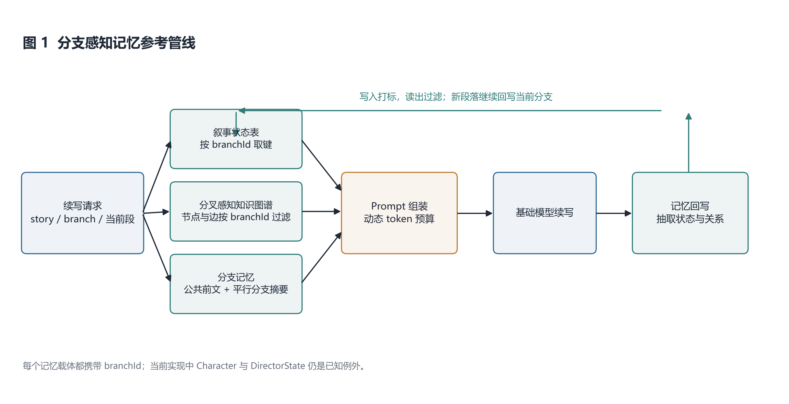
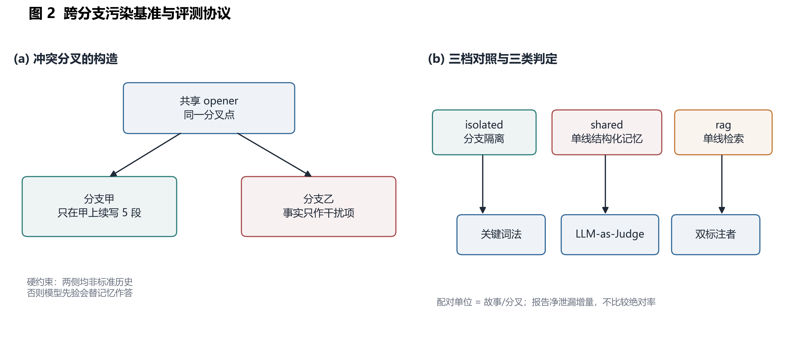
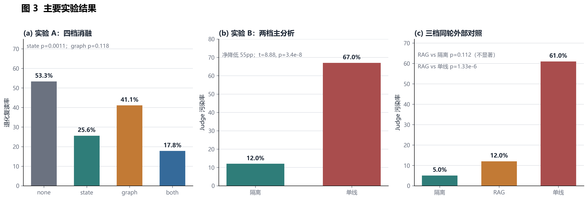

# 面向多分支叙事一致性的跨分支事实泄漏基准与参考管线

## 摘要

长程叙事生成通常依赖外部记忆维持一致性，但既有状态表、知识图谱与检索式记忆默认故事只有一条时间线。互动小说与故事树场景允许同一前文分出多条互斥分支，单线记忆会把平行分支的事实当作当前历史注入，造成跨分支事实泄漏。本文将这一问题形式化为分支树上的记忆边界问题，构建包含 20 组冲突分叉的诊断性基准，并提出一条显式携带分支标识的参考管线。基准要求每条分叉的两侧均为非标准历史，避免模型先验替代记忆；每条样本在分支甲上连续续写 5 段，重复 3 轮，共得到 600 段主分析样本。评测采用关键词法、LLM-as-Judge 与双标注者人工核验，并报告逐故事配对检验。结果显示，状态表记忆将退化复读发生率从 53.3% 降至 25.6%（t = −3.62，p = 0.0011），图谱单独使用不显著（41.1%，p = 0.118）；分支隔离将跨分支污染率从 67% 降至 12%（净降低 55 个百分点，t = 8.88，p = 3.4×10⁻⁸，逐故事 19 胜 1 平 0 负）。在同一批故事的三档外部对照中，分支隔离为 5%、BM25 单线 RAG 为 12%、单线结构化记忆为 61%；RAG 显著优于单线结构化记忆（p = 1.33×10⁻⁶），但与分支隔离的差异不显著（p = 0.112）。两位标注者的标注者间 κ = 0.668，人工加权净泄漏增量为 57.4%–69.9%，与自动判定的 55.0% 同向。在 10 个代表性分叉的 Qwen3.7-Plus 探索性复验中，档位排序与主实验一致（隔离 4%、RAG 12%、单线 48%），但该复验仅用于检查模型依赖性。本文将贡献定位为可复现的跨分支一致性基准、评测协议与参考管线，不宣称显著优于 RAG。

**关键词：** 多分支叙事；长程一致性；记忆增强；跨分支事实泄漏；基准评测；大语言模型

---

## 1 引言

大语言模型已经能够生成通顺的单段叙事，但当生成长度扩展到数十段后，长程一致性仍是最主要的失败模式之一：已经死去的角色重新出场、被毁的城池再次被攻、上一段说“粮尽”而下一段却“兵精粮足”。这类错误在单段阅读中并不明显，只有与数十段之前的历史对照时才会暴露。已有工作因此普遍将记忆从模型参数中分离出来，做成可检索、可更新的外部结构，例如状态表、实体关系图和原始文本检索[1-3]。

上述记忆系统的共同前提是：故事只有一条时间线。因而“全部历史”可以按时间顺序组织，检索时只需判断“与当前上下文多相关”。互动小说、同人续写和故事树类应用并不满足这一前提。读者可以在任意段落上分叉，同一前文之下，一条支线让主角北上求援，另一条让主角南下死守；分叉还可以继续分叉。故事因此不是一条线，而是一棵分支树。

多分支结构对记忆提出了单线场景不存在的要求：记忆必须同时按“时间”和“分支”两个维度组织；在当前分支上检索到的历史，不能包含只发生在平行分支上的事实。沿用单线记忆会造成跨分支事实泄漏，即分支 A 中写定的人物、地点或事件状态被注入到分支 B 的续写中，模型于是顺着 A 的既成事实把 B 写下去。污染直接削弱了分叉创作的意义：读者选择另一条路的价值，正在于那条路上发生的事不同。

本文将跨分支事实泄漏形式化为分支树上的记忆边界问题，并给出一个可复现的诊断性基准与参考管线。具体贡献包括：

1. **问题定义。** 将故事表示为分支树，把“当前分支可见的历史”与“平行分支事实”区分开，给出跨分支污染的操作化定义。
2. **诊断性基准。** 构造 20 组冲突分叉；每条分叉的两侧互斥且都不是标准历史，避免模型先验替代记忆。主分析包含 20 组 × 2 档 × 5 段 × 3 轮，共 600 段。
3. **实证结论。** 状态表记忆显著降低退化复读；图谱单独使用不显著；分支隔离显著优于单线结构化记忆。与此同时，BM25 RAG 是一个强外部基线，与分支隔离的污染率差异不显著。
4. **评测与工程记录。** 并行报告关键词法、LLM-as-Judge、双标注者人工核验与配对统计；记录指标失效、构念错位和输出不稳定性等可复现工程事实。

本文不把“提出了一个全新的架构”作为主张。状态表与图谱统一在一条参考管线中，但实验只支持状态表部分；图谱单独使用未达显著。我们将该管线定位为可复现的参考实现，并把 RAG 作为必须并列报告的强基线。

---

## 2 相关工作

### 2.1 叙事一致性与记忆增强

SCORE[1] 追踪叙事关键对象的 key-value 状态，使查询退化为精确匹配，并以分层摘要与混合检索处理软性矛盾；其 NCI-2.0 指标将叙事一致性分为角色稳定、事件因果、时间线连续和情感连贯四个维度。本文的四维评分器沿用这一体系。DOME[2] 将已生成内容抽取为实体关系图，以时序知识图谱作为记忆增强模块，并配合动态分层大纲；其记忆结构仍然是单线的。MemLong[3] 等以段落原文做检索增强，保真度高，但检索结果冗长且噪声较大。

这些工作的共同点是：记忆可以按时间顺序组织，检索只需考虑相关性。本文指出，在多分支叙事下这一前提不成立；记忆还需要一个分支维度。

### 2.2 长程记忆与一致性评测

LoCoMo[4] 将长期对话评测扩展到最长 35 个会话，采用“LLM agent 生成 + 人工核验”的数据构造，并以人物设定与时间事件图保证长程一致。LongMemEval[5] 将长期记忆拆成信息抽取、跨会话推理、时间推理、知识更新和拒答五项能力，并用 500 个问题评测长对话历史。二者都把时间跨度拉长，但会话历史仍是单一时间线；同一分叉点分出两条互斥走向的维度未被覆盖。

### 2.3 叙事质量的自动评测

让强模型充当法官已经成为通行做法。Zheng 等[6] 系统研究了 LLM-as-a-Judge 的位置偏差、冗长偏差和自我增强偏差，并以 Cohen's κ 衡量与人类的一致性。本文不做成对比较，而采用逐条独立判定，从设计上规避位置偏差；同时区分逐段一致率与聚合结论的吻合度。

OpenMEVA[7] 评的是故事生成指标本身，发现自动指标与人类判断的相关性普遍较差。HelloBench[8] 将长文本生成拆成五类任务，并观察到长文本中的重复与质量下降。StoryBench[9] 面向连续故事可视化，强调跨帧一致性和人工评估准则。本文受这些工作启发，同时报告关键词法与 LLM 判官，并公开二者的分歧。

### 2.4 基准构建方法论

HELM[10] 强调多指标、标准化 prompt 和原始输出公开。构念效度研究[11] 系统审查了大量 LLM 基准，指出所测现象、任务与评分指标之间可能发生错位。BetterBench[12] 给出基准全生命周期的最佳实践，Datasheets for Datasets[13] 要求记录数据集的动机、构成、采集、用途边界与维护方式。本文按这些原则记录 20 组冲突分叉的构造约束、规模、判定协议、统计口径和已知失效模式。

---

## 3 方法

### 3.1 问题定义

一个故事 $S$ 是一棵分支树。树的根是一条线性前文，每个节点是一个段落，边表示“下一段”。在任意段落上都可以生成新的子节点，从而开启一条新的分支。段落 $s$ 带有分支标识 $b(s)$，并沿 `parentSegmentId` 指回父段。一条分支 $B$ 是若干段落的序列，其中相邻两段有父子关系，且所有段落的分支标识相同。两条分支的分叉点是它们共享的最深祖先：

$$\mathrm{fork}(B_1,B_2)=\arg\max_{s\in B_1\cap B_2}\mathrm{depth}(s).$$

续写任务为：给定故事 $S$、当前分支 $B$ 与当前末端段落 $s_t$，生成下一段 $s_{t+1}$，使其在文体上与 $s_t$ 一致、在事实上与 $B$ 上 $s_t$ 之前的全部历史一致，且不被 $B$ 之外的分支上的事实影响。

### 3.2 参考管线

参考管线由四个阶段构成：

1. **记忆检索。** 按当前 `branchId` 查询叙事状态表、分叉感知知识图谱和分支记忆；
2. **Prompt 组装。** 按动态 token 预算把记忆块注入生成模板；
3. **续写生成。** 使用基础模型生成下一段；
4. **记忆回写。** 从新段落抽取状态与实体关系，写回当前分支。



> **图 1** 分支感知记忆参考管线。写入时打标、读取时按 `branchId` 过滤；新段落继续回写当前分支。

### 3.3 叙事状态表

状态表追踪对一致性有影响的叙事关键对象，包括角色、地点、势力、物品、关系和时间事件。每个对象的状态采用符号化 key-value 表示，例如 `{location: "漠北", status: "俘虏", isAlive: false}`。符号表示使冲突检测退化为精确匹配：同一个键被赋予两个互斥值时，可以直接检出。

每写完一段，系统调用模型做一次增量更新，按 `(name, branchId)` 合并进已有状态表，并刷新 `lastSeenSegmentId`。注入时取最近活跃的若干对象，按类型分组渲染为 Prompt 块；空属性不输出。

### 3.4 分叉感知知识图谱

知识图谱将角色、地点、事件等实体及其关系组织为节点和边。节点与边都携带 `branchId`，检索时只返回当前分支可见的子图。图谱适合表示“谁与谁结盟”“谁与谁交战”这类关系，但它需要先把自然语言抽取成实体和关系，再经过一步推理才能用于续写。本文将其作为参考管线的一部分，但实验 A 对该模块的单独效果进行独立检验。

### 3.5 分支隔离与已知例外

参考实现要求记忆检索和回写的每一步都携带 `branchId`。状态表使用按分支隔离的键名空间，知识图谱在节点和边上过滤分支，分支记忆则根据分叉点和当前分支检索。分叉点由父指针链上最近公共祖先确定。

该原则在实现中有两处例外：角色登记表 `Character` 是故事级结构，没有 `branchId`；导演状态 `DirectorState` 以 `storyId` 唯一，也没有分支维度。实验脚本在角色登记层做了隔离，避免平行分支角色被写入当前分支的 Prompt；这两处结构限制在 §6.3 中作为已知局限报告。

---

## 4 评测方法与实验设置

### 4.1 冲突分叉基准

基准包含 20 组冲突分叉。每条分叉在同一个 opener 之后给出两条互斥走向；续写只在分支甲上进行，分支乙的事实仅作为干扰项进入记忆。构造必须同时满足：

1. 两侧互斥；
2. 两侧均非标准历史；
3. marker 不能出现在共享 opener 中，也不能是模型仅凭题材常识就会主动写出的词。

第二条约束来自 v1 的失败：当乙分支等于标准历史时，模型先验会替记忆回答问题。v1 的 12 组设计只得到 12 个百分点的净增量且不显著；改为两侧均非标准历史后，效应才稳定出现。



> **图 2** 跨分支污染基准的构造与三档评测协议。每条分叉的两侧都必须是非标准历史。

主分析采用 20 组 × 2 档 × 5 段 × 3 轮，共 600 段。外部对照采用同一批 20 组故事 × 3 档 × 5 段 × 3 轮，共 900 段。主分析与外部对照来自不同跑批，绝对污染率不混合比较。

### 4.2 三档与判定器

| 档位 | 记忆空间 | 分支过滤 | 注入方式 |
|---|---|:---:|---|
| isolated（本文） | 分支甲、乙分库存放 | 有 | 状态表 + 图谱 |
| shared（强泄漏对照） | 两套事实挂到同一空间 | 无 | 结构化事实直接注入 |
| rag（外部基线） | 两套事实进入同一检索池 | 无 | BM25 top-3 检索 |

当前环境未配置 embedding 端点，RAG 实际使用中文二元组 BM25 和 top-3 检索，不能写成 embedding RAG。每个续写段同时使用关键词法与 LLM-as-Judge 进行跨分支污染判定。关键词法统计乙分支专属 marker 的命中；LLM 判官接收甲、乙两条分支设定与正文，判断主角是否确实进入乙的地点、做了乙的事件或处于乙的状态。关键词法客观但粗糙，LLM 判官覆盖语义但需要效度锚定，因此两者并列报告。

### 4.3 统计口径

配对单位是故事或分叉，不是段落或轮次。同一故事的多段具有相关性，把它们当作独立样本会虚增样本量；增加轮次只降低单个故事的测量噪声，不增加样本量。实验 A 以故事为单位，实验 B 以分叉组为单位，分别使用配对 t 检验。一次分析含多个比较时采用 Bonferroni 校正，并报告真实 p 值。

### 4.4 人工评估

从实验 B 的 600 段中分层抽取 36 条，按档位、关键词法和判官结果分 8 层，并做槽位去重、正文逐字去重和单故事上限。两位组内标注者独立复标；A 有 1 条“说不准”，B 有 4 条，二分类可比样本为 31 条。

两位标注者的 A × B 一致率为 83.9%，Cohen's κ = 0.668。A × Judge κ = 0.471，B × Judge κ = 0.613，共识 × Judge κ = 0.675。按逆概率权重还原到 600 段总体，A 的净泄漏增量为 57.4%，B 为 69.9%，Judge 为 55.0%。本文报告人工口径范围 57.4%–69.9%，不把 57.4% 写成两位标注者的共同结果。

5 条不一致样本（S05、S22、S20、S34、S32）保留双方原始标签。当前没有第三人终裁，因此论文只报告原始判定与分歧，不把任何建议写成最终人工真值。两位标注者均来自同一研究组且非盲于研究假设，κ 只能衡量彼此一致，不能消除共同期望偏差。

### 4.5 图文一致性辅助实验

为检验外观锚点在文本层与图像层的传递，本文另做 8 个故事 × 3 段 × 前后两种管线的配对实验，共 48 格，实际得到 45 张有效 PNG、1 张占位 SVG 和 2 格缺图。两组共享同段落文本、同画风和同一 per-segment seed。图像层使用 0–6 分外观呈现分和相邻段“同一人”判定；文本层检查锚点逐字复用和外观关键词覆盖。

图像层评分由 AI 按冻结 rubric 完成，人工盲评模板已生成但尚未完成，因此图像层结果只作辅助与方向性证据。

---

## 5 实验结果

### 5.1 实验 A：记忆注入消融

实验 A 使用 30 个中国历史/古典故事，四档分别为 `none`、`state`、`graph`、`both`，每档连续 5 段，重复 3 轮，共 1800 段。

| 档位 | 退化复读率 | 统计结果 |
|---|---:|---|
| none | 53.3% | 基线 |
| state | 25.6% | t = −3.62，df = 29，p = 0.0011 |
| graph | 41.1% | t = −1.61，p = 0.118 |
| both | 17.8% | t = −4.98，p < 0.0001 |

状态表显著降低退化复读；图谱单独使用未达显著；叠加档在数值上最低，但不显著优于状态表，模块互补性没有得到证据。实验 A 的效应与故事原本的复读严重程度相关：基线越高的故事，状态表带来的绝对下降越大。30 个故事是按功效分析预先确定的样本量，本文不继续扩样。

### 5.2 实验 B：跨分支污染主分析

两档主分析包含 20 组 × 2 档 × 5 段 × 3 轮，共 600 段。

| 档位 | 关键词法 | Judge 法 | 两法一致率 |
|---|---:|---:|---:|
| 分支隔离 | 41% | 12% | 70% |
| 单线结构化记忆 | 79% | 67% | 82% |

净泄漏增量为 55 个百分点，配对 t = 8.88，df = 19，p = 3.4×10⁻⁸；逐故事 19 胜 1 平 0 负。唯一持平的是破釜沉舟（47% vs 47%）。未校正、3 比较 Bonferroni 和最保守的 4 比较 Bonferroni 三个判据均通过。

### 5.3 外部 RAG 对照

同一批 20 组故事的三档同轮重跑得到：

| 档位 | Judge 污染率 | 各轮 |
|---|---:|---|
| 分支隔离 | 5% | 4% / 5% / 7% |
| RAG（BM25 top-3） | 12% | 14% / 16% / 7% |
| 单线结构化记忆 | 61% | 69% / 53% / 61% |

配对检验以故事为单位：

- 隔离 vs 单线结构化：净降低 56 个百分点，t = 10.28，p = 3.35×10⁻⁹，20 胜 0 平 0 负；
- RAG vs 单线结构化：净降低 48.7 个百分点，t = 6.93，p = 1.33×10⁻⁶，18 胜 1 平 1 负；
- RAG vs 隔离：RAG 高 7 个百分点，t = 1.67，p = 0.112，7 胜 9 平 4 负，不显著。

这说明检索式单线记忆本身就是一个强基线。本文可以主张分支隔离显著优于强泄漏的单线结构化记忆，但不能主张显著优于 RAG。两档主结果与三档对照来自不同跑批，绝对值不混合汇报。

### 5.4 人工评估结果

人工评估与 §4.4 的口径一致：标注者间 κ = 0.668，A/B 加权净增量 57.4%/69.9%，Judge 为 55.0%。三者方向一致，但人工点估计差异明显，故论文报告范围而不是单一共识值。关键词法与人工的一致性仍接近随机到轻微水平（A × 关键词法 κ = 0.00，B × 关键词法 κ = 0.18），只能作为粗筛。

### 5.5 图文一致性结果

| 指标 | 优化前 | 优化后 | 检验 |
|---|---:|---:|---|
| 锚点逐字命中 | 0/22 | 22/22 | McNemar p < 0.001 |
| 关键词覆盖 | 89.7% | 100% | Wilcoxon p = 0.0039 |
| 逐图外观分 | 5.13 ± 1.15 | 5.15 ± 0.98 | p = 0.791 |
| 相邻段同一人 | 9/14 (64.3%) | 12/14 (85.7%) | McNemar p = 0.375 |

文本层锚点传递稳定；图像层逐图外观分持平；相邻段身份判定只有方向性，不显著。由于人工盲评尚未完成，图像层数字只能作为辅助证据，不能写成已人工确认的收益。



> **图 3** 主要实验结果。(a) 实验 A 四档消融；(b) 实验 B 两档主分析；(c) 三档同轮外部 RAG 对照。
> 注意：两档主结果为 12% / 67%，三档重跑为 5% / 12% / 61%，两组绝对值来自不同跑批，不能混合汇报。

### 5.6 第二模型探索性复验

为检查主实验的档位排序是否只属于 `deepseek-chat`，本文用 Qwen3.7-Plus 替换续写生成，
保持记忆抽取与 Judge 不变，在 10 个代表性分叉上做 1 轮探索性复验：

| 档位 | Judge 污染率 |
|---|---:|
| 分支隔离 | 4% |
| RAG 单线检索 | 12% |
| 单线结构化记忆 | 48% |

隔离 vs 单线的净降低为 44 个百分点（t = 4.13，df = 9，p = 0.0026；8 胜 1 平 1 负），
RAG 与隔离的差异为 8 个百分点但不显著（t = 1.81，p = 0.1039）。有一组反向
（破釜沉舟：隔离 40% vs 单线 20%），其余故事方向与主实验一致。该复验只有 10 个分叉、
1 轮，只用于检验趋势的模型依赖性，不替代主实验的 20 组 × 3 轮统计结论。

---

## 6 讨论

### 6.1 为什么状态表有效、图谱单独无效

状态表注入的是可直接引用的属性，例如“刘备驻北平”“某角色已死亡”。在降低退化复读这个被解释变量上，模型只需要复用当前状态，不需要经过关系推理。图谱注入的是关系三元组，模型需要先把关系用于情节推断，链路更长；在 5 段续写范围内，这种间接收益没有稳定出现。叠加档没有显著优于状态表，说明“增加更多记忆结构”不是充分条件。

### 6.2 RAG 强基线对论文定位的影响

BM25 单线 RAG 的污染率显著低于单线结构化记忆，但与分支隔离的 7 个百分点差异不显著（p = 0.112）。这意味着检索本身已经过滤掉大量无关事实，本文不能把“显著优于任何单线记忆”作为无条件结论。更准确的定位是：

1. 本文给出一个针对平行分支的诊断性基准；
2. 参考管线显著优于强泄漏的单线结构化记忆；
3. RAG 是强外部基线，与参考管线在污染率上相当；
4. 结构化状态、分支语义和可控性是否带来额外收益，需要另外的指标验证。

Qwen 探索性复验支持档位排序的跨模型一致性，但仍不足以替代多模型统计；若论文以方法优势为主卖点，下一步应补 embedding RAG/top-k 敏感性和状态一致性/可控性等差异化指标；若以基准与参考管线为主卖点，当前结果足以支撑一篇诚实的 Benchmark + Pipeline 论文。

### 6.3 局限

1. **主实验单一基础模型。** 主统计全部使用 `deepseek-chat`；Qwen3.7-Plus 复验只有 10 个分叉、1 轮，属于探索性检查，不足以完成跨模型泛化验证。
2. **RAG 口径有限。** 当前仅使用 BM25 top-3；embedding RAG、不同检索器和 top-k 敏感性未做。
3. **人工样本与来源。** 36 条样本、两位同组标注者，5 条分歧未终裁；κ 不能消除共同期望偏差。
4. **图像层未人工锚定。** 图像评分为 AI 按冻结 rubric 完成，人工盲评模板已生成但未完成，身份指标 p = 0.375，只能写方向性。
5. **KG 抽取质量未评测。** 本文没有把 KG 抽取 P/R/F1 作为已完成结果；图谱在实验 A 中单独使用不显著。
6. **续写长度有限。** 每个分叉只有 5 段，跨分支污染在更长续写中的累积未测。
7. **实现例外。** 角色登记表和导演状态仍缺少 `branchId`，当前实验脚本只在角色登记层做了隔离。

---

## 7 结论

本文研究多分支叙事中的跨分支事实泄漏，并给出可复现的诊断性基准与参考管线。与把故事视为单一时间线的既有记忆系统不同，本文将叙事结构显式表示为分支树，把记忆写入与检索统一到 `branchId` 维度，并通过“同一起点、两条互斥且均非标准历史的分支、只在一条分支上续写”的构造，使平行分支事实成为可控干扰项。

实验给出两条方向不同的结论。第一，状态表记忆显著降低退化复读，说明结构化、可直接引用的状态信息在长程续写中有效；知识图谱单独使用未达显著，叠加也没有稳定优于单模块，说明增加更多记忆结构本身不是充分条件。第二，分支隔离在 20 组冲突分叉上显著优于单线结构化记忆，净降低 55 个百分点，逐故事 19 胜 1 平 0 负。v1 设计的失败也一并保留：当乙分支等于标准历史时，模型先验会替记忆回答问题，净增量只有 12 个百分点且不显著。

外部 RAG 对照进一步限定了结论边界。BM25 单线 RAG 的污染率为 12%，显著低于单线结构化记忆的 61%，但与分支隔离的 5% 差异不显著。因此本文不能声称参考管线显著优于 RAG；可以成立的主张是：分支隔离显著优于强泄漏的单线结构化记忆，并且在污染率上与 RAG 相当。RAG 是本文必须并列报告的强基线。

人工评估支持主结果的方向，但精度有限。两位标注者的 Cohen's κ = 0.668，人工加权净增量范围为 57.4%–69.9%，自动判定为 55.0%。三者同向，但点估计差异明显，且两人同组、非盲于研究假设。图文实验的文本层锚点传递稳定，图像层身份一致性仅有方向性（p = 0.375），尚不能作为显著收益。

后续工作将扩展 Qwen 等第二模型的样本量与轮次，补 embedding RAG 与 top-k 敏感性、
更长续写，以及带外部标注者的跨分支与跨模态联合评测。

---

## 参考文献

[1] YI Q, HE Y, WANG J, et al. SCORE: Story Coherence and Retrieval Enhancement for AI Narratives[EB/OL]. arXiv:2503.23512, 2025.

[2] WANG Q, HU J, LI Z, et al. Generating Long-form Story Using Dynamic Hierarchical Outlining with Memory-Enhancement[EB/OL]. arXiv:2412.13575, 2024.

[3] LIU W, TANG Z, LI J, et al. MemLong: Memory-Augmented Retrieval for Long Text Modeling[EB/OL]. arXiv:2408.16967, 2024.

[4] MAHARANA A, LEE D-H, TULYAKOV S, et al. Evaluating Very Long-Term Conversational Memory of LLM Agents[EB/OL]. arXiv:2402.17753, 2024.

[5] WU D, WANG H, YU W, et al. LongMemEval: Benchmarking Chat Assistants on Long-Term Interactive Memory[EB/OL]. arXiv:2410.10813, 2024.

[6] ZHENG L, CHIANG W-L, SHENG Y, et al. Judging LLM-as-a-Judge with MT-Bench and Chatbot Arena[EB/OL]. arXiv:2306.05685, 2023.

[7] GUAN J, ZHANG Z, FENG Z, et al. OpenMEVA: A Benchmark for Evaluating Open-ended Story Generation Metrics[EB/OL]. arXiv:2105.08920, 2021.

[8] QUE H, DUAN F, HE L, et al. HelloBench: Evaluating Long Text Generation Capabilities of Large Language Models[EB/OL]. arXiv:2409.16191, 2024.

[9] BUGLIARELLO E, MORALDO H, VILLEGAS R, et al. StoryBench: A Multifaceted Benchmark for Continuous Story Visualization[EB/OL]. arXiv:2308.11606, 2023.

[10] LIANG P, BOMMASANI R, LEE T, et al. Holistic Evaluation of Language Models[EB/OL]. arXiv:2211.09110, 2022.

[11] BEAN A M, KEARNS R O, ROMANOU A, et al. Measuring what Matters: Construct Validity in Large Language Model Benchmarks[EB/OL]. arXiv:2511.04703, 2025.

[12] REUEL A, HARDY A, SMITH C, et al. BetterBench: Assessing AI Benchmarks, Uncovering Issues, and Establishing Best Practices[EB/OL]. arXiv:2411.12990, 2024.

[13] GEBRU T, MORGENSTERN J, VECCHIONE B, et al. Datasheets for Datasets[EB/OL]. arXiv:1803.09010, 2018.

[14] KIELA D, BARTOLO M, NIE Y, et al. Dynabench: Rethinking Benchmarking in NLP[EB/OL]. arXiv:2104.14337, 2021.

[15] SRIVASTAVA A, RASTOGI A, RAO A, et al. Beyond the Imitation Game: Quantifying and extrapolating the capabilities of language models[EB/OL]. arXiv:2206.04615, 2022.

---

## 附录 A 数据与代码

实验 A 数据：`ablation_results_*s30x5seg*.json`；汇总：`s30_rounds_report.md`、`s30_robustness.md`。

实验 B 两档数据：`branch_isolation_n20_2026-10-06T*.json`；汇总：`branch20_rounds_report.md`。

实验 B 三档 RAG 数据：`branch_isolation_n20_rag20_*.json`；汇总：`branch20_rag_report.md`。

人工评估：`human_eval/人工评估报告.md`、`human_eval/标注者间一致性报告.md`。

论文图：`figures/fig1_pipeline.png`、`fig2_benchmark.png`、`fig3_results.png`。

复现命令：

```bash
cd D:/项目/Another-chance-new
npx tsc --noEmit
npm test
npx tsx tests/ab_ablation.ts --report-only
npx tsx tests/ab_branch_isolation.ts --report-only --out=branch20_rounds_report.md
python scripts/make_paper_figures.py
```
